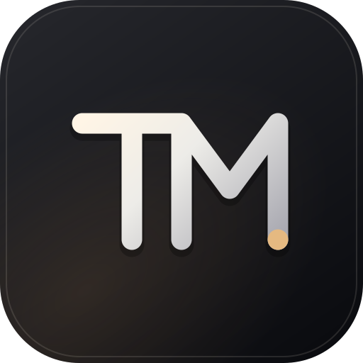
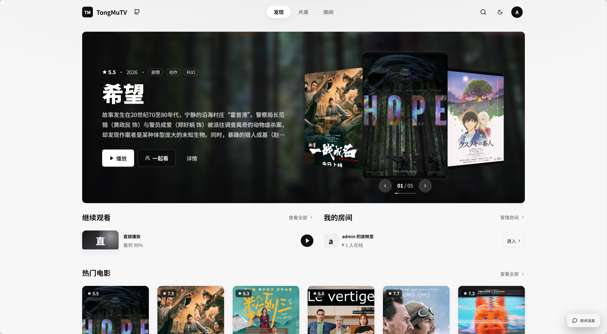
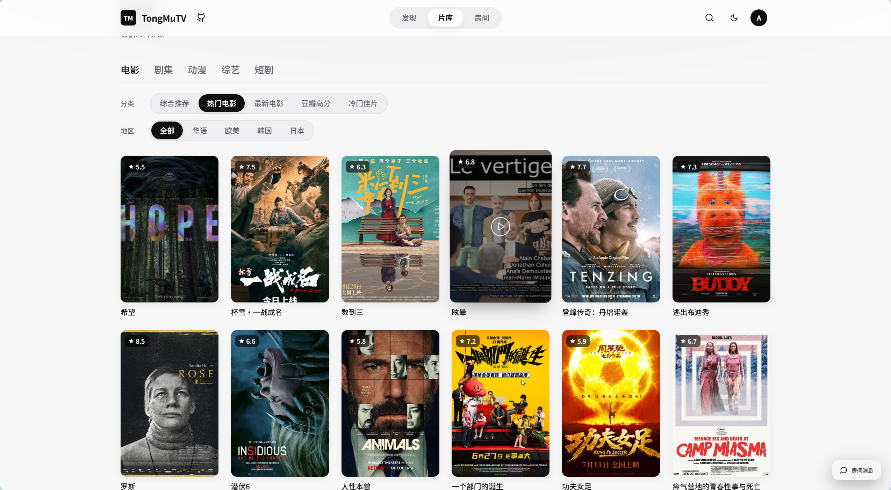
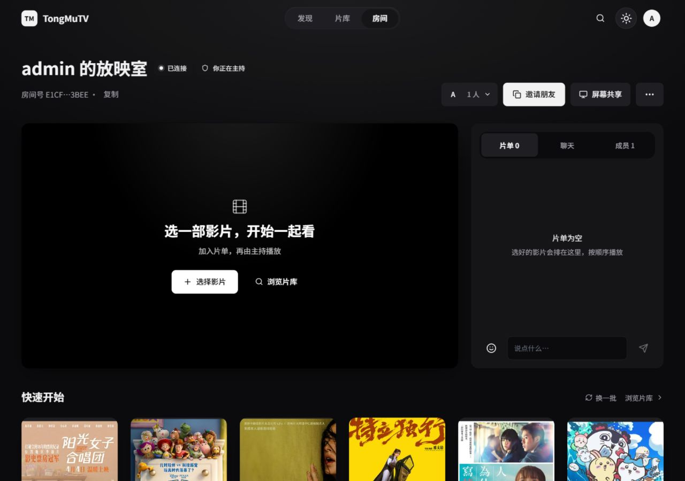
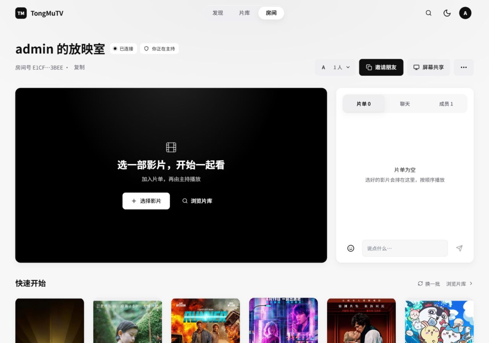

<div align="center">



# TongMuTV Plus

**和朋友一起看电影的私人影视站。**
自己看片，也能开一个房间：大家的进度同步，边看边聊。

简体中文 | [English](README_en.md)


</div>



## 这是什么

TongMuTV Plus 是一个自己部署的影视站，给一小圈朋友用：站长部署一个实例，用邀请码把朋友拉进来。

它有两个平级的核心功能：

- **自己看**：搜片、逛豆瓣榜单，播放、选集、弹幕，下次从「继续观看」接着看。
- **一起看**：建一个房间，把链接发给朋友。片单大家共享，播放、暂停、拖进度、换集全员同步，边看边聊，还能开语音、共享屏幕。

项目最初基于 [MoonTVPlus](https://github.com/mtvpls/MoonTVPlus)，之后独立发展：品牌、界面、播放页和整个一起看都是重新做的，不再跟随上游更新。

能看哪些片取决于站长自己配置的影视源。本项目不提供任何影视内容。

## 亮点

- **真正同步的房间**：房间只有一份播放状态，由服务器时钟推算进度，谁有权限谁就能操作，不靠某一台“主持设备”。成员断线重连、晚进房间，都会自动对齐到当前进度。
- **按账号分权限**：控制播放、换片换集、加片单、管理片单、聊天、语音发言，房主可以分别开关。
- **换页面不断播**：自己看和一起看共用一种小窗，可拖动、吸附到角落，也能收起成一条。
- **手机、平板、电脑各有一套排版**：不是电脑页面缩小。手机一屏装下；平板有自己的侧栏和触屏按钮；电脑和 Windows 客户端适配鼠标和键盘。
- **房间弹幕**：聊天可以飘成带名字的弹幕，和弹幕库里的弹幕分开开关。

## 界面预览

### 影视片库 · 浅色



### 同步观影房间 · 深色与浅色

| 深色主题                                           | 浅色主题                                            |
| -------------------------------------------------- | --------------------------------------------------- |
|  |  |

## 下载客户端

不想一直开着浏览器？到 **[Releases · 客户端下载](https://github.com/XYL333FYQ/TongMuTVPlus/releases/tag/clients)** 下载安装包。

客户端是网页的“壳”：**第一次打开时填你自己服务器的地址**就能用。网站更新后客户端自动跟着更新，不用重装。

| 平台                          | 文件                                                                                              | 说明                                                   |
| ----------------------------- | ------------------------------------------------------------------------------------------------- | ------------------------------------------------------ |
| Windows 10 / 11               | `TongMuTV-Plus-Windows-x64-Setup.exe`（ARM 设备用 `arm64`）                                       | 安装版。`Ctrl+Shift+S` 更换地址，`F11` 全屏            |
| Windows 10 / 11（免安装）     | `TongMuTV-Plus-Windows-x64-Portable.zip`（ARM 设备用 `arm64`）                                    | 解压双击即用，可以放在 U 盘里；需要系统自带的 WebView2 |
| 安卓手机（Android 6 ~ 15）    | `TongMuTV-Plus-Android.apk`                                                                       | 长按桌面图标可以「更换服务器地址」                     |
| 安卓电视 / 盒子（Android 5+） | `TongMuTV-Plus-TV-webview-android6plus.apk`（其他版本怎么选见 [说明](apps/android-tv/README.md)） | 遥控器长按「菜单」键更换地址                           |

- Windows 第一次运行会出现 SmartScreen 提示（安装包没有买代码签名证书）：点「更多信息 → 仍要运行」。
- 安卓安装需要允许「安装未知来源应用」。
- 不支持 Windows 7 / 8 和华为纯血鸿蒙，这些设备请直接用浏览器打开。iPhone 和 Mac 可以在浏览器里「添加到主屏幕」。

## 功能

### 核心

| 功能         | 说明                                                                          |
| ------------ | ----------------------------------------------------------------------------- |
| 影视库       | 聚合站长配置的影视源：搜索、详情、选集、豆瓣榜单和推荐                        |
| 播放         | HLS / MP4、弹幕、字幕、画质增强；播放记录和首页「继续观看」                   |
| 连续播放     | 换页面不断播，小窗可拖动、吸附、收起；自己看和房间共用                        |
| 同步观影房间 | 公开房 / 私密房、房间密码、邀请链接；共享片单；播放、暂停、进度、换集全员同步 |
| 房间权限     | 按账号设置：控制播放、换片换集、加片单、管理片单、聊天、语音发言              |
| 房间互动     | 聊天和表情、房间弹幕、语音、共享屏幕、同步听歌、同步看直播                    |
| 长期房间     | 没人时自动暂停、休眠；空闲 30 天自动归档，站长可以关闭这个功能                |
| 视频直链     | 房间里可以直接加 `.mp4` / `.m3u8` 地址                                        |
| 账号         | 邀请码注册、电视扫码登录、OIDC 单点登录；站长 / 管理员 / 成员三种角色         |
| 管理面板     | 影视源、用户、站点设置、公告，在线备份和恢复                                  |
| 界面         | 深色 / 浅色 / 跟随系统；手机、平板、电脑各有排版；支持减弱动效、关闭模糊      |

### 附加（来自上游，能用，但没有逐项深度验收）

电视直播（m3u + 节目单）、网络直播（B 站 / 虎牙 / 抖音直播间）、短剧、音乐、漫画、电子书（兼容阅读 App 书源）、私人影库、求片、AI 找片。

> 房间的「视频直链」只接受视频文件地址，**不解析** B 站、腾讯视频这类网页地址。

## 部署

推荐用 Docker 部署到自己的 VPS。一起看依赖一直在线的 WebSocket 服务，只有 Docker（以及其他能长期运行 Node 进程的方式）能完整支持。

### 用 Docker 部署到 VPS

**准备**

- 一台 Linux VPS：建议 2 核 / 2 GB 内存以上（在服务器上构建镜像需要约 2 GB 内存；直接拉取构建好的镜像 1 GB 也够）
- 装好 Docker 和 Docker Compose 插件
- 一个域名，A 记录指向这台 VPS（房间依赖 WebSocket，建议走 HTTPS）

**1. 获取代码并配置**

```bash
git clone https://github.com/XYL333FYQ/TongMuTVPlus.git
cd TongMuTVPlus
cp .env.example .env
nano .env
```

`.env` 里至少要改这几项：

| 变量                   | 说明                                                                                             |
| ---------------------- | ------------------------------------------------------------------------------------------------ |
| `PASSWORD`             | **必填**，站长密码。请用别处没用过的强密码                                                       |
| `USERNAME`             | 站长用户名，默认 `admin`                                                                         |
| `TONGMU_IMAGE`         | 留空：在服务器上构建；填 `ghcr.io/xyl333fyq/tongmutvplus:latest`：直接拉取 GitHub 自动构建的镜像 |
| `AUTH_SECRET`          | 登录签名密钥。留空会在第一次启动时自动生成，保存到 `.data/auth-secret`                           |
| `ROOM_ALLOWED_ORIGINS` | 反向代理改写了 Host 时，填站点地址，例如 `https://tv.example.com`                                |

其他房间参数（人数上限、休眠、归档等）见 [.env.example](.env.example)。

**2. 启动**

```bash
# 方式 A：在服务器上构建（TONGMU_IMAGE 留空）
docker compose up -d --build

# 方式 B：拉取构建好的镜像（TONGMU_IMAGE 已填写）
docker compose pull && docker compose up -d
```

确认已经启动：

```bash
docker compose ps
curl http://127.0.0.1:3000/health/ready
```

服务默认只监听 `127.0.0.1:3000`，需要通过反向代理对外访问。

**3. 配置 HTTPS 反向代理**

任选一种：

- **Caddy**（推荐，自动申请证书）：参考 [deploy/Caddyfile.example](deploy/Caddyfile.example)
- **Nginx**：参考 [deploy/nginx.conf.example](deploy/nginx.conf.example)，证书用 certbot 申请

不管用哪种，都要转发 `/socket.io/` 的 WebSocket，并把空闲超时设到 60 秒以上，否则房间会频繁断线。

**4. 上线以后**

1. 用站长账号登录，在**管理面板**里添加影视源（没有影视源时搜不到任何影片）。
2. 要让朋友注册，就在管理面板里打开注册并设置邀请码。
3. 自己搜一部片子播放，再建一个房间，和朋友试一次同步。
4. 导出一次备份，妥善保存。

**更新**

```bash
git pull
docker compose up -d --build                  # 方式 A
docker compose pull && docker compose up -d   # 方式 B
```

更新前先备份。不要用 `docker compose down -v` 这类会删除数据卷的命令。

**数据和备份**

| 宿主机目录  | 内容                                                   |
| ----------- | ------------------------------------------------------ |
| `./.data`   | SQLite 数据库 `moontv.db` 和登录签名密钥 `auth-secret` |
| `./data`    | 离线下载目录                                           |
| `./backups` | 备份文件                                               |

在线备份（站点不用停）：

```bash
docker compose exec --user 0 tongmutvplus node scripts/ops/sqlite-backup.cjs --output /backups/$(date +%Y%m%d-%H%M%S).sqlite
```

恢复步骤和注意事项见 [docs/operations.md](docs/operations.md)。管理面板里也可以导出 / 导入全站数据。

### 其他平台

仓库里还保留了 Render、Vercel、Cloudflare Workers、腾讯云 EdgeOne Pages 的部署配置，平时不用，需要时随时能用。Render 跑的就是上面的 Docker 镜像，一起看完整可用；另外三个是无服务器平台，不能常驻 WebSocket 服务，**一起看需要另外连一个外部房间服务**，自己看和其他功能不受影响。各平台的步骤、所需环境变量和验证情况见 [部署说明](docs/deploy.md)。

## 本地开发

需要 Node 24 和 pnpm。

```bash
pnpm install
cp .env.example .env    # 填写 PASSWORD
pnpm dev                # 打开 http://localhost:3000
```

写代码前先看 [代码规范](docs/STANDARD.md)。提交前要通过的检查（CI 里也会跑）：

```bash
pnpm typecheck
pnpm lint
pnpm test
pnpm test:rooms
pnpm format:check
pnpm check:structure
```

在 Windows 本机执行 `pnpm build`，可能因为 standalone 符号链接权限报 EPERM；Linux 和 Docker 构建不受影响。

## 文档

全部文档的目录见 [docs/README.md](docs/README.md)，常用的几份：

- [代码规范](docs/STANDARD.md)
- [部署说明](docs/deploy.md)
- [运行、备份与恢复](docs/operations.md)
- [架构说明](docs/architecture.md)
- [产品范围与验收约定](docs/requirements.md)

## 致谢与许可

- 项目起点是 [MoonTVPlus](https://github.com/mtvpls/MoonTVPlus)，感谢原作者和贡献者。
- 使用 [CC BY-NC-SA 4.0](LICENSE) 许可：可以自由使用和修改，但不能用于商业用途，改动后的版本也要用同样的许可发布。
- 本项目只是一个播放和同步工具，不存储、不提供任何影视内容。请遵守你所在地区的法律，只使用你有权访问的内容。
