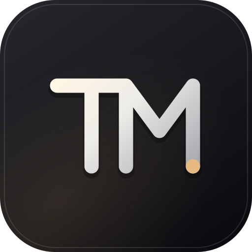
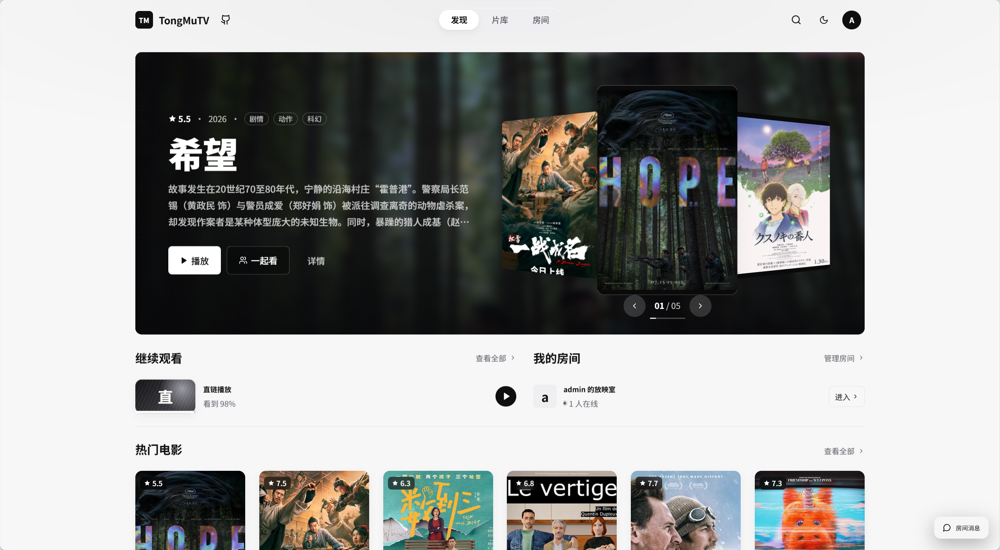
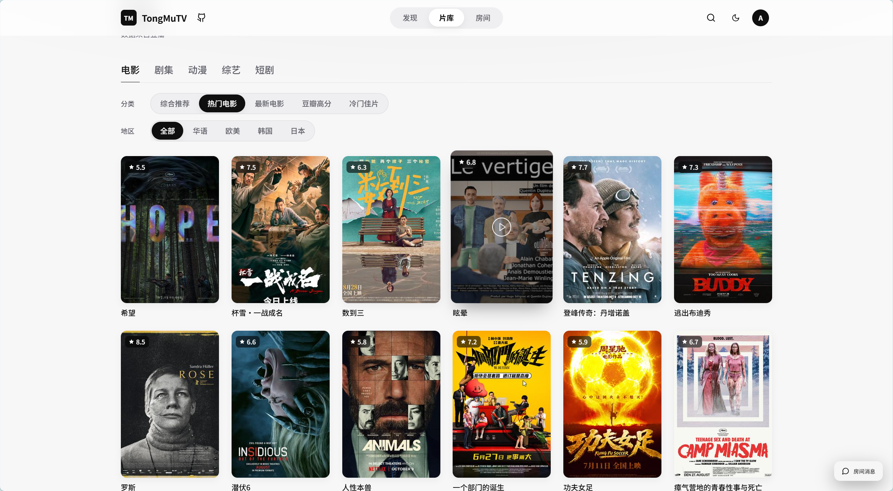
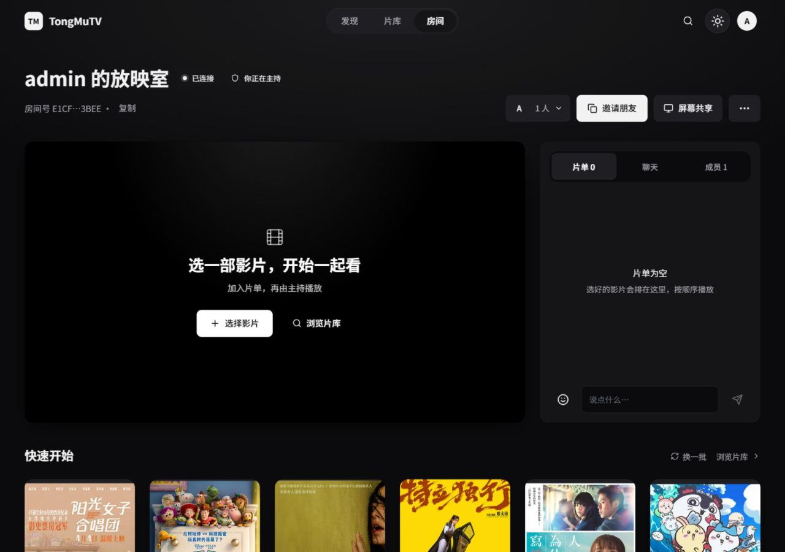
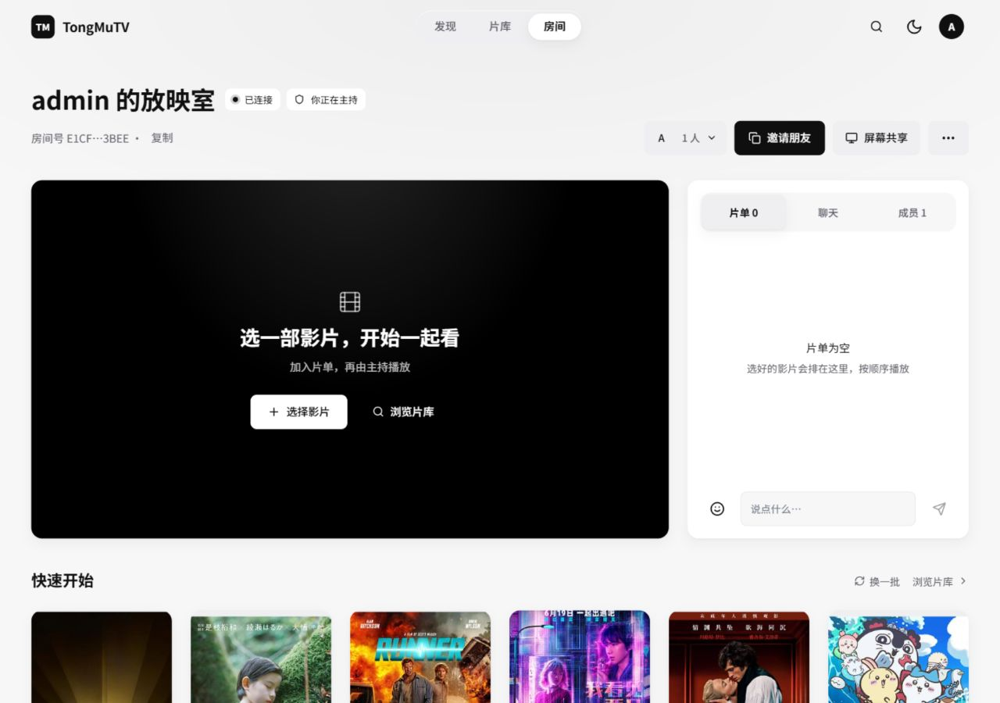

<div align="center">



# TongMuTV Plus

**和朋友一起看电影的私人影视站**：自己看片，也能开个房间，大家进度同步、边看边聊。

简体中文 | [English](README_en.md)


</div>



## 这是什么

TongMuTV Plus 基于 [MoonTVPlus](https://github.com/mtvpls/MoonTVPlus) 进行特色化改造，拥有独立的产品品牌、房间体验与界面，面向**邀请制的小圈子**：站长部署一个实例，用邀请码拉朋友进来。

两个平级的核心功能：

- **自己看**：搜片、看豆瓣榜单，播放、选集、弹幕，下次从「继续观看」接着看。
- **一起看**：建一个房间把链接发给朋友，片单共享，播放 / 暂停 / 拖进度全员同步，边看边聊。

能看哪些片取决于站长配置的影视源。本项目不提供任何影视内容。

## 下载客户端

不想一直开浏览器？到 **[Releases · 客户端下载](https://github.com/XYL333FYQ/TongMuTVPlus/releases/tag/clients)** 取安装包。客户端是套壳：**首次打开填你自己服务器的地址**即可，网站更新后客户端自动同步，不用重装。

| 平台                          | 文件                                                                                              | 说明                                         |
| ----------------------------- | ------------------------------------------------------------------------------------------------- | -------------------------------------------- |
| Windows 10 / 11               | `TongMuTV-Plus-Windows-x64-Setup.exe`（ARM 设备用 `arm64`）                                       | 安装版。`Ctrl+Shift+S` 更换地址，`F11` 全屏  |
| Windows 10 / 11（免安装）     | `TongMuTV-Plus-Windows-x64-Portable.zip`（ARM 设备用 `arm64`）                                    | 解压双击即用，可放 U 盘；需系统自带 WebView2 |
| 安卓手机（Android 6 ~ 15）    | `TongMuTV-Plus-Android.apk`                                                                       | 长按桌面图标可「更换服务器地址」             |
| 安卓电视 / 盒子（Android 5+） | `TongMuTV-Plus-TV-webview-android6plus.apk`（其余版本的选择见 [说明](apps/android-tv/README.md)） | 遥控器长按「菜单」键更换地址                 |

- Windows 首次运行会出现 SmartScreen 提示（安装包没有买代码签名证书）：点「更多信息 → 仍要运行」。
- 安卓安装需要允许「安装未知来源应用」。
- 不支持 Windows 7 / 8、华为纯血鸿蒙；这些设备请直接用浏览器访问。iPhone / Mac 可用浏览器「添加到主屏幕」。

## 功能

### 核心（已测试和走查）

| 功能         | 说明                                                                        |
| ------------ | --------------------------------------------------------------------------- |
| 影视库       | 聚合站长配置的影视源，支持搜索、详情、选集、豆瓣榜单与推荐                  |
| 播放         | HLS / MP4，弹幕，播放记录，首页「继续观看」                                 |
| 全站连续播放 | 换页面不断播；可缩成小窗（可拖动、自动吸附到角落）或收起                    |
| 同步观影房间 | 公开 / 私密房、房间密码、邀请链接；共享片单；播放、暂停、进度实时同步；聊天 |
| 主持交接     | 房主掉线有 30 秒重连宽限，之后交给预先授权的成员；可切换「仅自己看」        |
| 长期房间     | 无人时自动暂停、休眠；空闲 30 天归档，站长可关闭                            |
| 视频直链     | 房间里可直接加入 `.mp4` / `.m3u8` 地址                                      |
| 账号         | 邀请码注册、电视端扫码登录、OIDC 单点登录；站长 / 管理员 / 成员三种角色     |
| 管理面板     | 影视源、用户、站点设置、公告、在线备份与恢复                                |
| 界面         | 深色 / 浅色 / 跟随系统，手机竖屏适配，支持减弱动效                          |

### 附加（继承自上游，可用但未逐项深度验收）

电视直播（m3u + 节目单）、网络直播（B 站 / 虎牙 / 抖音直播间）、短剧、音乐、漫画、电子书（兼容阅读 App 书源）、私人影库、求片、AI 找片，以及房间内的同步听歌、同步直播、屏幕共享、语音。

> 房间的「视频直链」只接受视频文件地址，**不解析** B 站、腾讯视频等网页地址。

## 界面预览

### 影视片库 · 浅色



### 同步观影房间 · 深色与浅色

| 深色主题                                           | 浅色主题                                            |
| -------------------------------------------------- | --------------------------------------------------- |
|  |  |

## 部署到 VPS（Docker）

### 准备

- 一台 Linux VPS：建议 2 核 / 2 GB 内存以上（在服务器上构建镜像需要约 2 GB 内存；直接拉取构建好的镜像则 1 GB 也够用）
- 已安装 Docker 与 Docker Compose 插件
- 一个域名，A 记录指向 VPS（用于 HTTPS；观影房间依赖 WebSocket，建议走 HTTPS）

### 1. 获取代码并配置

```bash
git clone https://github.com/XYL333FYQ/TongMuTVPlus.git
cd TongMuTVPlus
cp .env.example .env
nano .env
```

`.env` 里至少要改：

| 变量                   | 说明                                                                                              |
| ---------------------- | ------------------------------------------------------------------------------------------------- |
| `PASSWORD`             | **必填**，站长密码。用别处没用过的强密码                                                          |
| `USERNAME`             | 站长用户名，默认 `admin`                                                                          |
| `TONGMU_IMAGE`         | 留空则在服务器上构建；填 `ghcr.io/xyl333fyq/tongmutvplus:latest` 则直接拉取 GitHub 自动构建的镜像 |
| `AUTH_SECRET`          | 登录签名密钥。留空会在首次启动时自动生成并保存到 `.data/auth-secret`                              |
| `ROOM_ALLOWED_ORIGINS` | 反向代理改写了 Host 时，填站点地址，如 `https://tv.example.com`                                   |

其他房间参数（人数上限、休眠、归档等）见 [.env.example](.env.example)。

### 2. 启动

```bash
# 方式 A：在服务器上构建（TONGMU_IMAGE 留空）
docker compose up -d --build

# 方式 B：拉取构建好的镜像（TONGMU_IMAGE 已填写）
docker compose pull && docker compose up -d
```

检查是否就绪：

```bash
docker compose ps
curl http://127.0.0.1:3000/health/ready
```

服务默认只监听 `127.0.0.1:3000`，需要通过反向代理对外提供访问。

### 3. 配置 HTTPS 反向代理

任选其一：

- **Caddy**（推荐，自动申请证书）：参考 [deploy/Caddyfile.example](deploy/Caddyfile.example)
- **Nginx**：参考 [deploy/nginx.conf.example](deploy/nginx.conf.example)，证书用 certbot 申请

无论用哪种，都要转发 `/socket.io/` 的 WebSocket，并把空闲超时设为 60 秒以上，否则房间会频繁断线。

### 4. 上线后

1. 用站长账号登录，进入**管理面板**添加影视源（没有影视源时搜索不到任何影片）。
2. 需要朋友注册的话，在管理面板打开注册并设置邀请码。
3. 自己搜一部片子播放，再建个房间和朋友试一次同步。
4. 导出一次备份并妥善保存。

### 更新

```bash
git pull
docker compose up -d --build          # 方式 A
docker compose pull && docker compose up -d   # 方式 B
```

更新前先备份。不要用 `docker compose down -v` 之类会删除数据卷的命令。

### 数据与备份

| 宿主机目录  | 内容                                                   |
| ----------- | ------------------------------------------------------ |
| `./.data`   | SQLite 数据库 `moontv.db` 和登录签名密钥 `auth-secret` |
| `./data`    | 离线下载目录                                           |
| `./backups` | 备份文件                                               |

在线备份（站点不用停）：

```bash
docker compose exec --user 0 tongmutvplus node scripts/ops/sqlite-backup.cjs --output /backups/$(date +%Y%m%d-%H%M%S).sqlite
```

恢复步骤和注意事项见 [docs/operations.md](docs/operations.md)。管理面板里也可以导出 / 导入全站数据。

## 本地开发

需要 Node 24 和 pnpm。

```bash
pnpm install
cp .env.example .env    # 填写 PASSWORD
pnpm dev                # http://localhost:3000
```

常用检查：

```bash
pnpm typecheck
pnpm lint
pnpm test
pnpm test:rooms
```

Windows 本机执行 `pnpm build` 可能因 standalone 符号链接权限报 EPERM，Linux / Docker 构建不受影响。

## 文档

- [运行、备份与恢复](docs/operations.md)
- [架构说明](docs/architecture.md)
- [产品范围与验收约定](docs/requirements.md)
- [上游 MoonTVPlus 原始说明](docs/upstream-moontvplus-README.md)（更多配置项和其他部署方式）

## 声明

- 本项目仅供学习和个人使用，不提供任何影视内容，也不对影视源的内容负责。
- 请设置强密码，默认关闭公开注册，只在小范围内使用，不要公开传播你的实例地址。
- 请遵守所在地法律法规；因使用本项目产生的任何法律责任由使用者自行承担。

## 许可证与致谢

本项目沿用上游的 [CC BY-NC-SA 4.0](LICENSE) 许可证：可以修改和分享，但须署名、**不得用于商业用途**，衍生作品须以相同许可证发布。

感谢 [MoonTVPlus](https://github.com/mtvpls/MoonTVPlus)、[MoonTV / LunaTV](https://github.com/MoonTechLab/LunaTV)、[LibreTV](https://github.com/LibreSpark/LibreTV)、[ArtPlayer](https://github.com/zhw2590582/ArtPlayer)、[HLS.js](https://github.com/video-dev/hls.js) 以及所有贡献者。
