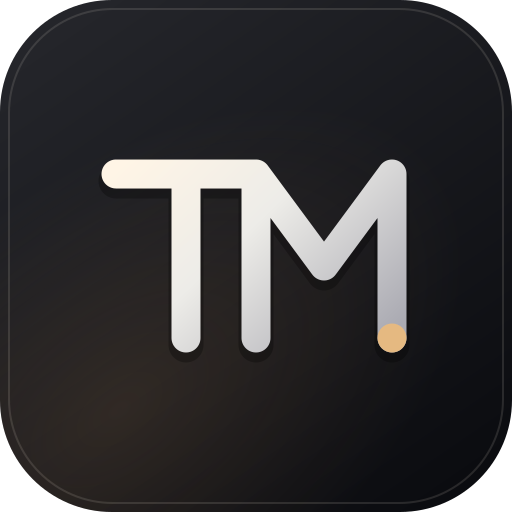
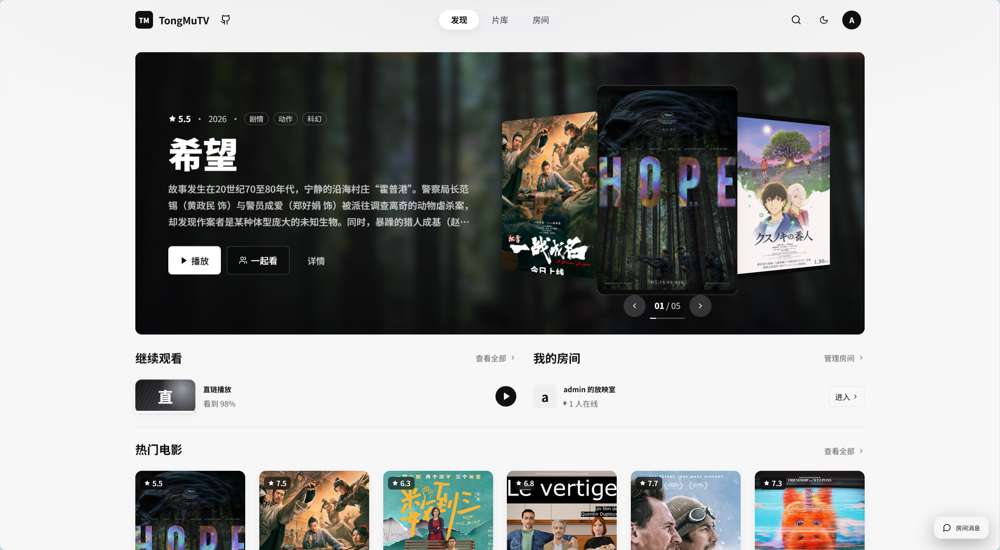
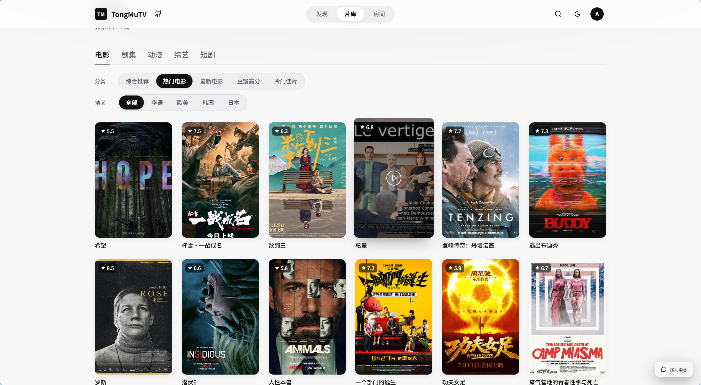
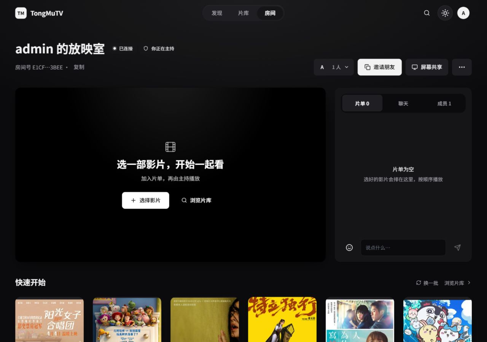
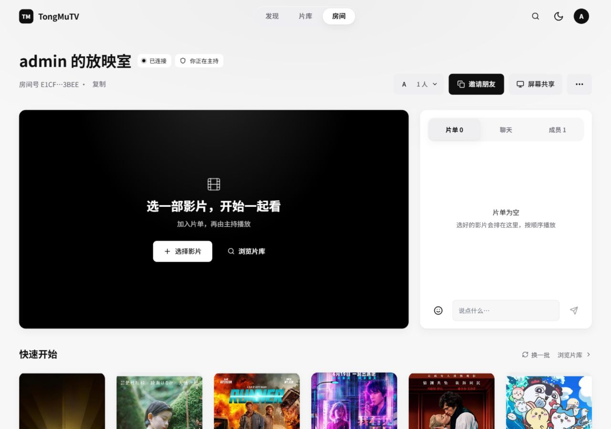

<div align="center">



# TongMuTV Plus

**A private movie site for watching films with friends.**
Watch on your own, or open a room: everyone stays in sync and chats while watching.

[简体中文](README.md) | English


</div>



## What it is

TongMuTV Plus is a self-hosted movie site for a small circle of friends: the owner deploys one instance and invites friends with invite codes.

It has two equal core features:

- **Watch on your own**: search, browse the Douban charts, play, pick episodes, danmaku, and pick up where you left off from "Continue watching".
- **Watch together**: create a room and send the link. The playlist is shared; play, pause, seeking and episode changes are synced for everyone. Chat while watching, with voice chat and screen sharing.

The project started from [MoonTVPlus](https://github.com/mtvpls/MoonTVPlus) and has since gone its own way: the brand, the interface, the play page and the whole watch-together feature were rebuilt, and it no longer follows upstream.

What you can watch depends on the video sources the owner configures. This project provides no content.

## Highlights

- **Rooms that really stay in sync**: a room has a single playback state; the position is projected from the server clock. Whoever has the permission can control playback — there is no single "host device". Members who reconnect or join late are aligned to the current position automatically.
- **Per-account permissions**: control playback, change film / episode, add to the playlist, manage the playlist, chat, speak in voice chat — the owner can switch each one on or off.
- **Playback survives navigation**: watching alone and rooms share one mini player that can be dragged, snapped to a corner, or folded into a strip.
- **A real layout for each device**: not a shrunk desktop page. Phones fit on one screen; tablets get their own side panel and touch buttons; desktop and the Windows client are built for mouse and keyboard.
- **Room danmaku**: chat messages can fly across the video with the sender's name, switched separately from danmaku from the danmaku library.

## Screenshots

### Library · light



### Watch-together room · dark and light

| Dark                                      | Light                                       |
| ----------------------------------------- | ------------------------------------------- |
|  |  |

## Clients

Don't want to keep a browser tab open? Download an installer from **[Releases · clients](https://github.com/XYL333FYQ/TongMuTVPlus/releases/tag/clients)**.

The clients are shells around the website: **enter your own server's address the first time you open one**. When the site is updated the clients follow automatically — no reinstall.

| Platform                        | File                                                                                                        | Notes                                                                   |
| ------------------------------- | ----------------------------------------------------------------------------------------------------------- | ----------------------------------------------------------------------- |
| Windows 10 / 11                 | `TongMuTV-Plus-Windows-x64-Setup.exe` (`arm64` for ARM devices)                                             | Installer. `Ctrl+Shift+S` changes the address, `F11` toggles fullscreen |
| Windows 10 / 11 (portable)      | `TongMuTV-Plus-Windows-x64-Portable.zip` (`arm64` for ARM devices)                                          | Unzip and run, works from a USB stick; needs the system WebView2        |
| Android phones (Android 6–15)   | `TongMuTV-Plus-Android.apk`                                                                                 | Long-press the home-screen icon to change the server address            |
| Android TV / boxes (Android 5+) | `TongMuTV-Plus-TV-webview-android6plus.apk` (see the [notes](apps/android-tv/README.md) for other versions) | Long-press the remote's Menu key to change the address                  |

- On first run Windows shows a SmartScreen warning (the installer is not code-signed): choose "More info → Run anyway".
- On Android, allow "Install unknown apps".
- Windows 7 / 8 and HarmonyOS NEXT are not supported — use a browser there. On iPhone and Mac, use "Add to Home Screen" in the browser.

## Features

### Core

| Feature              | Description                                                                                                                      |
| -------------------- | -------------------------------------------------------------------------------------------------------------------------------- |
| Library              | Aggregates the owner's video sources: search, details, episodes, Douban charts and recommendations                               |
| Playback             | HLS / MP4, danmaku, subtitles, upscaling; watch history and "Continue watching" on the home page                                 |
| Continuous playback  | Keeps playing across pages; the mini player can be dragged, snapped and folded; shared with rooms                                |
| Watch-together rooms | Public / private rooms, room passwords, invite links; shared playlist; play, pause, seek and episode changes synced for everyone |
| Room permissions     | Per account: control playback, change film / episode, add to / manage the playlist, chat, voice                                  |
| Room interaction     | Chat and emoji, room danmaku, voice chat, screen sharing, listen to music together, watch live TV together                       |
| Long-lived rooms     | Auto-pause and sleep when empty; archived after 30 idle days (the owner can turn this off)                                       |
| Direct video links   | Add `.mp4` / `.m3u8` addresses straight into a room                                                                              |
| Accounts             | Invite-code sign-up, TV QR-code login, OIDC single sign-on; owner / admin / member roles                                         |
| Admin panel          | Video sources, users, site settings, announcements, online backup and restore                                                    |
| Interface            | Dark / light / follow system; a layout per device; reduced motion and no-blur options                                            |

### Extras (from upstream; they work, but have not each been fully re-tested)

Live TV (m3u + EPG), live streams (Bilibili / Huya / Douyin rooms), short dramas, music, manga, e-books (compatible with Legado book sources), private library, film requests, AI search.

> A room's "direct video link" only accepts video file addresses; it **does not parse** web pages such as Bilibili or Tencent Video.

## Deployment

The recommended way is Docker on your own VPS. Watching together needs an always-on WebSocket service, which only Docker (or anything else that keeps a Node process running) fully supports.

### Docker on a VPS

**You need**

- A Linux VPS: 2 cores / 2 GB RAM or more recommended (building the image on the server needs about 2 GB; pulling the prebuilt image works with 1 GB)
- Docker and the Docker Compose plugin
- A domain with an A record pointing at the VPS (rooms use WebSocket; HTTPS recommended)

**1. Get the code and configure it**

```bash
git clone https://github.com/XYL333FYQ/TongMuTVPlus.git
cd TongMuTVPlus
cp .env.example .env
nano .env
```

Change at least these in `.env`:

| Variable               | Description                                                                                                 |
| ---------------------- | ----------------------------------------------------------------------------------------------------------- |
| `PASSWORD`             | **Required.** The owner's password — use a strong one you don't use anywhere else                           |
| `USERNAME`             | The owner's username, `admin` by default                                                                    |
| `TONGMU_IMAGE`         | Empty: build on the server. `ghcr.io/xyl333fyq/tongmutvplus:latest`: pull the image built by GitHub Actions |
| `AUTH_SECRET`          | Login signing key. If empty, one is generated on first start and saved to `.data/auth-secret`               |
| `ROOM_ALLOWED_ORIGINS` | If your reverse proxy rewrites the Host header, set the site address, e.g. `https://tv.example.com`         |

Other room settings (member limits, sleep, archiving…) are in [.env.example](.env.example).

**2. Start**

```bash
# Option A: build on the server (TONGMU_IMAGE empty)
docker compose up -d --build

# Option B: pull the prebuilt image (TONGMU_IMAGE set)
docker compose pull && docker compose up -d
```

Check that it is running:

```bash
docker compose ps
curl http://127.0.0.1:3000/health/ready
```

The service only listens on `127.0.0.1:3000` by default; expose it through a reverse proxy.

**3. HTTPS reverse proxy**

Pick one:

- **Caddy** (recommended, certificates are automatic): see [deploy/Caddyfile.example](deploy/Caddyfile.example)
- **Nginx**: see [deploy/nginx.conf.example](deploy/nginx.conf.example), with certificates from certbot

Either way, forward WebSocket on `/socket.io/` and set the idle timeout above 60 seconds, or rooms will keep disconnecting.

**4. After it is up**

1. Sign in as the owner and add video sources in the **admin panel** (without sources, search finds nothing).
2. To let friends sign up, enable registration and set an invite code in the admin panel.
3. Play something yourself, then create a room and try syncing with a friend.
4. Export a backup and keep it somewhere safe.

**Updating**

```bash
git pull
docker compose up -d --build                  # option A
docker compose pull && docker compose up -d   # option B
```

Back up before updating. Never use commands that delete volumes, such as `docker compose down -v`.

**Data and backups**

| Host directory | Contents                                                            |
| -------------- | ------------------------------------------------------------------- |
| `./.data`      | SQLite database `moontv.db` and the login signing key `auth-secret` |
| `./data`       | Offline downloads                                                   |
| `./backups`    | Backup files                                                        |

Online backup (no downtime):

```bash
docker compose exec --user 0 tongmutvplus node scripts/ops/sqlite-backup.cjs --output /backups/$(date +%Y%m%d-%H%M%S).sqlite
```

Restore steps and caveats are in [docs/operations.md](docs/operations.md). The admin panel can also export / import all site data.

### Other platforms

The repository also keeps deployment configs for Render, Vercel, Cloudflare Workers and Tencent Cloud EdgeOne Pages. They are not used day to day but are ready when needed. Render runs the same Docker image, so watching together works fully; the other three are serverless and cannot keep a WebSocket service running, so **watching together needs a separate external room service** there — everything else works. Steps, environment variables and what has been verified are in the [deployment guide](docs/deploy.md) (Chinese).

## Local development

Requires Node 24 and pnpm.

```bash
pnpm install
cp .env.example .env    # set PASSWORD
pnpm dev                # open http://localhost:3000
```

Read the [code standard](docs/STANDARD.md) (Chinese) before writing code. Checks that must pass before committing (CI runs them too):

```bash
pnpm typecheck
pnpm lint
pnpm test
pnpm test:rooms
pnpm format:check
pnpm check:structure
```

Running `pnpm build` on Windows may fail with EPERM on standalone symlinks; Linux and Docker builds are unaffected.

## Documentation

The full index is [docs/README.md](docs/README.md) (Chinese). Most used:

- [Code standard](docs/STANDARD.md)
- [Deployment guide](docs/deploy.md)
- [Operations, backup and restore](docs/operations.md)
- [Architecture](docs/architecture.md)
- [Scope and acceptance](docs/requirements.md)

## Credits and license

- The project started from [MoonTVPlus](https://github.com/mtvpls/MoonTVPlus) — thanks to its authors and contributors.
- Licensed under [CC BY-NC-SA 4.0](LICENSE): free to use and modify, but not for commercial purposes, and modified versions must use the same license.
- This project is only a playback and sync tool. It does not store or provide any content. Follow the laws where you live and only use content you have the right to access.
