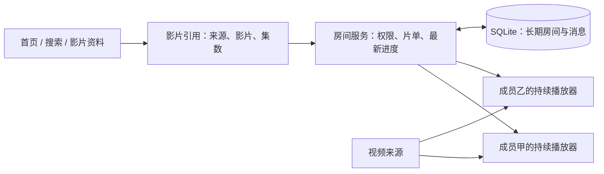
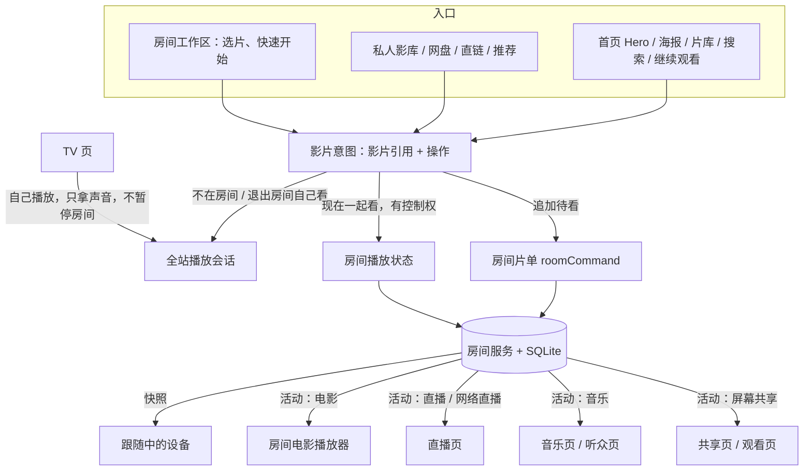

# TongMuTV Plus 怎么工作

本文说明当前改造的真实边界。需求和验收以 `requirements.md` 为准，完成程度以 `verification/` 的证据为准。设计成立、代码存在、影片真正播放成功，是三件不同的事。

## 从一次观看说起

你打开首页，先看到的是电影名称、海报、年份和介绍。这些信息叫“影片资料”，它们帮助你找片，但不代表本站已经拥有影片文件。游客只读取公开的影片资料，登录后才进入站长配置的播放来源。

你选中一部影片后，系统需要知道“哪个来源的哪部影片、哪一集”。这个组合相当于影片的取件号码。播放器用它请求详情和播放地址，再决定怎样播放。目录来源失效时可以替换来源，但不同来源的编号、集数和播放格式可能不同，不能把换一条地址当作全部兼容工作已经完成。

搜索结果已经带有简介时，海报详情直接展示这份简介，不必等另一家资料网站查询成功。片单里的「第 1 集」也必须实际播放第 1 集：房间明确集数优先于个人上次看到第几集；没有明确集数的个人观看才使用个人记录。已有片单在播放入口补上保存的集数，不为此改数据库。详见[目录接入复验](verification/browser-catalog-flow-20261009.md)。

如果拿到的是 MP4，浏览器通常直接向视频地址请求文件的一部分，边收边播放。如果拿到的是 HLS，通常会先读取 `.m3u8` 清单，再按清单请求一小段一小段的视频。地址后面的参数可能是通行凭证，因此不能为了判断扩展名而把参数丢掉。

“直连”指每个人的浏览器自己向原视频来源取片；“代理”指视频请求经过本站服务器再转交给原来源。优先直连，必要时才使用代理。代理解决的是请求怎样到达来源，不自动改善失效来源、浏览器不支持的编码或损坏的视频，也不应自动降低画质或转码。

## 一起看传递的是什么

房间主要交换影片引用、播放位置、播放/暂停、倍速和片单，通常不把房主画面再录制一遍传给所有人。服务器确认谁有主持权限，并保存房间的最新状态；每个成员的播放器各自取片、各自解码，再跟随同一条播放时间线。

“Socket.IO”是这里使用的长连接工具：网页和服务器保持联系，服务器有新消息时可以马上通知网页，不需要网页不断询问。它承载房间指令与聊天，不等于视频文件本身的传输方式。

### 2026-11-13 起：参照 SyncTV 的同步模型

旧实现是“唯一主持设备”：服务器在在线设备里选出一个主持（要求设备先声明就绪、跟随、租约、代次，房主回来再等 5 秒收回……），只有这台设备的播放器事件被采纳。任何一环没跟上，全房间就“暂无主持”，成员点暂停会被悄悄恢复播放。现在与 SyncTV 一致：

- **权限按账号算，不按设备算**：房主、房主设的管理员，以及房间开启“成员可以播放、暂停、拖动和换片”（默认开启）时的所有成员，都可以直接控制播放。房主可以在房间设置里关掉成员控制，此时只有房主和管理员能控制；没有权限的人操作会被拉回房间进度并看到原因。
- **服务器只保存一份播放状态**：`{ currentTime, isPlaying, playbackRate, updatedAt, version, updatedBy }`。任何人播放 / 暂停 / 拖动 / 倍速 / 换片，服务器立即更新并广播给其他人（操作者从回执拿到新状态）；后到的操作覆盖先到的，不再因为“房间版本变了”拒绝。`version` 单调递增（随状态入库，重启后继续递增），各端丢弃迟到的旧状态。
- **各端按服务器时钟推算位置**：连接后用 `time:sync` 做 NTP 式校准（取往返最快的一次），按 `currentTime + (服务器此刻 - updatedAt) × 倍速` 推算应在的位置。播放中偏差超过 1.2 秒（刚收到别人操作时 0.4 秒）才跳转，缓冲中不追，自动纠偏至少间隔 3 秒，避免弱网下反复卡顿。
- **本机跟随房间时产生的播放器事件会被抵消**，不会回声；只有与房间对齐过同一部影片之后，本机的播放 / 暂停 / 拖动 / 切集才算用户操作。加载、自动播放、恢复个人进度等内部动作都不会改动房间。
- **换片**：在房间选片器里点“立即一起看”、片单里点播放、播放器里切集或换源（含自动连播）都会成为房间新影片；切到别的集从头开始，只换片源则接着当前进度。多个成员同时自动连播到同一集只生效一次。
- 播放类命令不改房间结构版本、不广播完整快照，也不占用命令去重表；片单、设置、成员等结构性操作仍递增版本并广播快照。
- 旧客户端的 `room:ready` / `room:sync-applied` / `room:following` 仍返回成功（不再有任何作用），旧版本页面不会因此报错。
- **没有“个人观看”**：人在房间里，全站播放器就是房间的播放器。想自己看别的，就退出房间（成员身份保留）。旧实现里“跟随 / 个人观看”的半脱离状态让播放器位置取决于多种组合（小窗、舞台下方的黑框、点影片卡片悄悄脱离同步），已整体移除。

### 代码边界（2026-11-13 重新设计）

播放器不认识房间，房间通过一个小接口驱动播放器。依赖只有一个方向：房间 → 播放会话 → 播放页。

| 模块                                                                           | 负责                                                                                                                                                                                                                                                     | 不负责                 |
| ------------------------------------------------------------------------------ | -------------------------------------------------------------------------------------------------------------------------------------------------------------------------------------------------------------------------------------------------------- | ---------------------- |
| `src/features/room/sync/sync-engine.ts`                                        | 同步引擎（纯逻辑，无 React）：房间状态 + 本机权限 + 本机实际在放的影片 + 播放器接口 `PlayerPort` → 发命令 / 打开房间影片 / 对齐进度。以上所有同步规则都在这里，用假播放器和假时钟做单元测试                                                              | 界面、网络、React 状态 |
| `src/features/room/sync/drift.ts`                                              | 位置推算与阈值                                                                                                                                                                                                                                           | —                      |
| `src/features/room/RoomPlaybackBridge.tsx`                                     | 房间与全站播放器的唯一连接点：给引擎喂输入、执行引擎的决定、在播放会话上注册“打开另一部影片”的拦截器（加入片单 / 现在一起看 / 退出房间自己看）、在房间页重新打开被关掉的画面；对外提供 `useRoomPlayback()`（inRoom、locked、playTogether、shareCurrent） | 播放器内部、房间页布局 |
| `src/features/playback/PlaybackSessionProvider.tsx`                            | 放什么（href）、在哪显示（整页 / 舞台 / 小窗 / 收起）、播放器控制器、播放页上报的“实际在放的影片”（`reportMedia`）、拦截器挂点                                                                                                                           | 任何房间决策           |
| `src/features/playback/LegacyPlaybackSurface.tsx`                              | 解析片源、播放、选集、弹幕等；上报实际在放的影片；只读 `useRoomPlayback()` 的 inRoom / locked                                                                                                                                                            | 发房间命令、决定跟随谁 |
| `src/features/rooms/RoomWorkspace.tsx`                                         | 房间页的状态与操作                                                                                                                                                                                                                                       | 具体区域的渲染         |
| `RoomHeader` / `RoomStage` / `RoomSidePanel` / `RoomDirectory` / `RoomDialogs` | 各渲染一个区域，只拿用到的属性；表单自己管输入状态，提交时交回结果                                                                                                                                                                                       | 房间请求               |

几条由引擎保证的行为：

- 进入空房间时手上正放着影片：有控制权就带进房间（接着当前进度和播放/暂停）；没有控制权就收起，等房间开始播放。
- 本机影片和房间不同：是从房间影片换出去的（切集、换源、自动连播）或用户刚明确选择一起看的，且有控制权 → 成为房间影片；否则跟随房间。没有控制权还换片的，提示后回到房间影片。
- 关掉画面只是本机不看画面，人还在房间；离开房间页时不会自己弹回来，回到房间页或房间换片时重新打开。
- TV、直播、音乐页在房间里播放时不暂停房间影片（那会暂停整个房间），只把声音拿过去。

## 为什么换页面可以继续播放

普通网站经常把播放器放在播放页面里，离开该页面时，页面连同播放器一起被销毁。当前改造把播放器放到全站共同的外层，页面只负责决定它显示在哪里。

完整播放、房间内画面、小窗和折叠条，是同一个播放实例的不同显示形式。去搜索、打开收藏或收起画面，不应重新创建播放器、暂停影片或退出房间。明确换成另一部影片时，才允许更换影片对应的播放实例；失败重试也只重建媒体部分，不刷新整个网站。

这不是把两个网站互相塞进小窗口。页面之间共享的是明确的播放会话和房间状态，画面宿主保持稳定。`iframe` 是在网页里再装一个独立网页窗口；它适合某些独立工具，但如果两个窗口各有播放器、登录态和房间判断，就容易出现两份状态和两路声音。

同一浏览器多个标签页通过短期声音归属记录协调：只有一个标签页出声，另一个仍可保持画面解码和同步。它与“一个账号只有一个主持设备”是不同规则，后者由服务器决定。

## 影片、活动与房间怎样连接

先分清四件互不替代的事：**页面位置**（你在哪个页面）、**成员关系**（你是否在某个房间里）、**控制权**（按账号算：房主、管理员、房间开放成员控制时的成员）、**画面形态**（完整、舞台、小窗、折叠）。普通导航只改页面位置：不换片、不退房。

所有影片入口都走同一条路：用户打开一部影片 → 播放会话先问房间桥。不在房间里就直接播放；在房间里且是房间正在放的那部，直接显示；空房间且有控制权，直接一起看；否则弹出选择：加入房间片单、现在一起看（有控制权时）、退出房间自己看。服务器确认之前不宣布成功，回包绑定原房间，过期回包直接丢弃。

房间同一时刻只有一个**活动**：电影、直播、网络直播、音乐或屏幕共享，由服务器根据命令自动切换。几条统一规则：

- **浏览不是共享**：打开直播页或音乐页只是浏览，不替整个房间切活动；必须点“在房间播放”这类明确动作才发 `live:change` / `music:change` / `screen:start`。
- **有权限的人才能发布**：发布资格是“在房间 + 账号有控制权”（见上文权限规则）。没有控制权的成员可以追加待看、发聊天。屏幕共享由发起共享的人负责推流，断开或退出房间时自动结束共享。
- **快照只是输入**：收到房间快照更新本机显示，不再回发新指令，避免回声。
- **每个活动页自己的刷新恢复**：没有电影实例的活动里，设备在房间页自动声明就绪，主持才能在整页刷新后回来；屏幕共享页在刷新或关闭（`pagehide`）时释放“禁止连接”标记，主持可以结束或重开遗留的共享。
- **声音归属**：同一浏览器同一时刻只有一个出声者，其他继续解码但被静音；用户显式点播放才抢声音。语音是通话，不进这个租约。
- **语音**默认关（站点配置 `ENABLE_ROOM_VOICE`），关着不监听、不申请麦克风；服务端转发不看这个配置。
- **外部观影室服务**只提供 Socket 同步，不挂载房间 REST。外部模式下目录、首页“我的房间”和恢复不再请求必败的接口，直接显示边界说明；外部服务是否兼容本站房间协议没有验证。

## 聊天为什么要单独处理

消息有长期保存的序号和每个成员的已读位置。收到消息不等于读过消息；只有聊天中实际可见的消息，且网页处于前台并有焦点时，才提交已读位置。

重新加入时，服务器先返回最新一页，网页再按离线前的记录补齐缺口；更早的记录可以继续分页加载。补到一半失败，会保留已经补到的位置，下次继续。消息序号是数据库全表序号，跨房间有空洞很正常，不能要求每个房间的序号必须相邻。

切换房间、注销或换连接后，旧请求的迟到回包会被取消，避免把甲房间的消息或已读结果写进乙房间。客户端不保存私密房间的明文密码，重连依靠服务器保存的账号成员关系。

## 目录各自负责什么

| 位置                        | 职责                                                                                                                                                                                                                                                                                                                 | 应避免承担的工作                                                                             |
| --------------------------- | -------------------------------------------------------------------------------------------------------------------------------------------------------------------------------------------------------------------------------------------------------------------------------------------------------------------- | -------------------------------------------------------------------------------------------- |
| `src/app/`                  | 页面入口、服务端接口、现有来源功能                                                                                                                                                                                                                                                                                   | 在每个页面重新管理一套长期房间和播放器                                                       |
| `src/features/playback/`    | 全站播放会话、显示形态、声音协调、旧播放器接入                                                                                                                                                                                                                                                                       | 决定谁有服务器端主持权限                                                                     |
| `src/features/rooms/`       | 房间工作区、选片、片单、邀请和设置                                                                                                                                                                                                                                                                                   | 自行判定服务端操作成功，或只靠隐藏按钮保护权限                                               |
| `src/hooks/useWatchRoom.ts` | 连接、确认回包、快照、消息补齐与去重                                                                                                                                                                                                                                                                                 | 把客户端提供的用户名当成认证凭据                                                             |
| `src/features/room/`        | 房间同步引擎与房间 ↔ 播放器桥（见“代码边界”）                                                                                                                                                                                                                                                                        | 因页面卸载而替整个房间暂停或退房                                                             |
| `server/room-service.js`    | 房间规则、权限、播放状态、生命周期                                                                                                                                                                                                                                                                                   | 管理网页布局或选择浏览器的最终播放引擎                                                       |
| `server/room-store.js`      | SQLite 读写                                                                                                                                                                                                                                                                                                          | 判断界面应该显示小窗还是完整画面                                                             |
| `server/room-transport.js`  | HTTP/Socket 入口和请求校验                                                                                                                                                                                                                                                                                           | 再实现一份不同的房间规则                                                                     |
| `server/room-auth.js`       | 真实签名、账号状态与会话核对                                                                                                                                                                                                                                                                                         | 信任浏览器自报的名字、角色或旧 ownerToken                                                    |
| `scripts/ops/`              | 备份、恢复、负载演练                                                                                                                                                                                                                                                                                                 | 默认操作正式数据库或把测试结果当生产容量                                                     |
| `src/components/`           | 组件。TongMuTV 新增或重写的组件按功能域归组：`shell/`（导航、页头、返回顶部、账号入口）、`catalog/`（海报、片架、首页 Hero/房间、胶囊切换）、`feedback/`（Toast、确认框、告警框、图片查看、加载款式、移动操作表）、`account/`（主题与视觉偏好设置）；另有 `auth/ detail/ media/ music/ tv/ watch-room/` 等既有子目录 | 把上游原有组件也搬进分域目录（会放大与 MoonTVPlus 的合并冲突）；新增组件优先放进对应分域目录 |

旧播放器仍是较大的 `LegacyPlaybackSurface.tsx`，保留它是为了先保护成熟的字幕、来源处理和播放能力。把文件移动到新目录并不会自动消除内部耦合；后续拆分应以明确的行为回归为前提，逐块提取，而不是一次性重写上万行后只验证能够构建。

## 音乐、网页解析、直播与屏幕共享怎样扩展

现有功能按配置保留。未配置的入口应隐藏或给出真实的缺失说明，不能放一个按钮就宣称已经成熟。

成熟外部工具适合通过“接入层”连接：接入层把工具返回的内容整理成本站理解的影片、音乐、清单或播放信息。独立 API 服务可以单独升级和重启，但需要明确版本、认证、超时和失败提示；嵌入库更新更直接，却需要本站跟随其依赖与版本。两种方式都需要实际兼容测试。

电影网站网页解析需要另一个步骤：打开网页、找到播放器真正请求的媒体地址。无头浏览器是能运行网页但不显示普通窗口的浏览器，嗅探是观察其网络请求。无需登录只解决登录门槛，不能保证没有广告跳转、反自动化、加密播放器配置、短期签名或不兼容的视频编码。该能力保留为独立解析方向，不冒充现有 MP4/HLS 来源已经覆盖任意网页。

屏幕共享通常使用 WebRTC，把某个设备采集的屏幕实时传给其他设备；房间长连接帮助双方交换连接信息。弱网络、不同路由器或移动网络可能需要中继服务器，因此真实屏幕共享必须单独验收，不能用文字聊天成功或 50 条 Socket 连接成功来证明。

AI 推荐或总结需要实际的模型服务。自己部署网页不等于自己拥有模型算力或服务凭据；模型地址、模型名和密钥必须按所选服务配置。服务端负责调用，浏览器不应拿到站长的全局密钥。没有配置时保留明确的不可用状态，不承诺免费、无限或离线运行。

## 当前不能跳过的验证

先验证实际 MP4/HLS 解码，再验证两个账号的同步；再检查切页、小窗、折叠、断线恢复、消息已读和手机操作。单元测试帮助稳定规则，但不替代这些真实操作。容器启动、备份恢复和 50 连接信令演练也分别记录，不能互相代替。

最新证据见[实施状态](implementation-status.md)、[主持交接与消息续验](verification/browser-handoff-chat-navigation-20261009.md)和[媒体恢复与个人观看返回](verification/browser-media-recovery-20261009.md)。隔离 WSL/Linux 已实际运行，两账号 MP4/HLS 解码、连续播放、片单不换片、双标签声音、授权接管及房主返回已有浏览器证据；真实上游、后台/真机、安装与容器仍需验收，不能宣布发布完成。测试数量与当前运行边界以实施状态为准，历史批次不累加。

视频失败后的恢复入口也由全站播放层提供。原因是房间内嵌、小窗和折叠时，旧播放页的错误按钮可能被隐藏；聊天重连不会自动修好另一条视频请求。明确点击“重新加载影片”只重建本机媒体部分，再根据房间最新进度校准，不替其他成员暂停、退房或换片。

如果无人主持时影片自然结束，服务器按时间推算的进度可能超过片长。网页需要根据实际视频片长停在结尾，完成同步准备；房主接管后再提交真实暂停状态。这样不会因为反复要求播放不存在的第 156 秒而卡住主持恢复。直播或片长未知的内容不套用这个结尾判断。

### 组件目录说明

`src/components` 顶层仍保留上游 MoonTVPlus 原有组件，是有意的：大面积搬家会让后续合并全部变成改名加修改冲突。`admin/page.tsx`（禁区）直接引用 `AnimeSubscriptionComponent`、`CorrectDialog`、`DataMigration`、`PageLayout`，`useWatchRoom.ts`（禁区）的使用方引用 `WatchRoomProvider`，这五个必须留在原路径。分域目录里的组件一律用 `@/components/<域>/<名>` 引用，不用相对路径。
