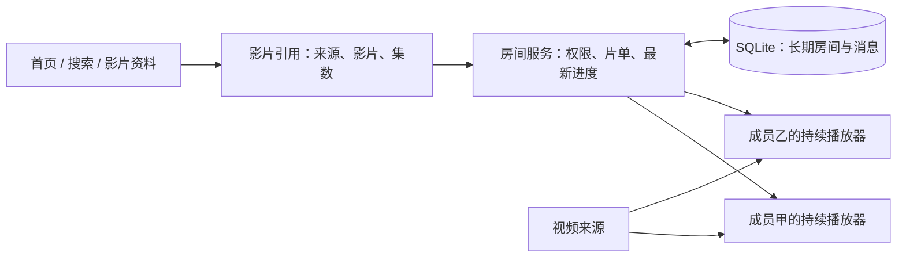
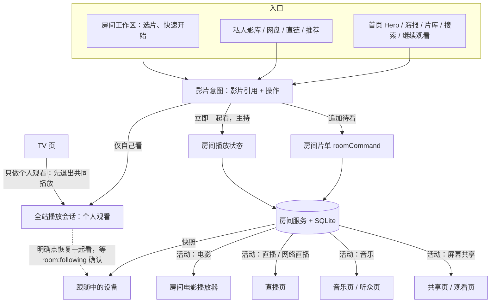
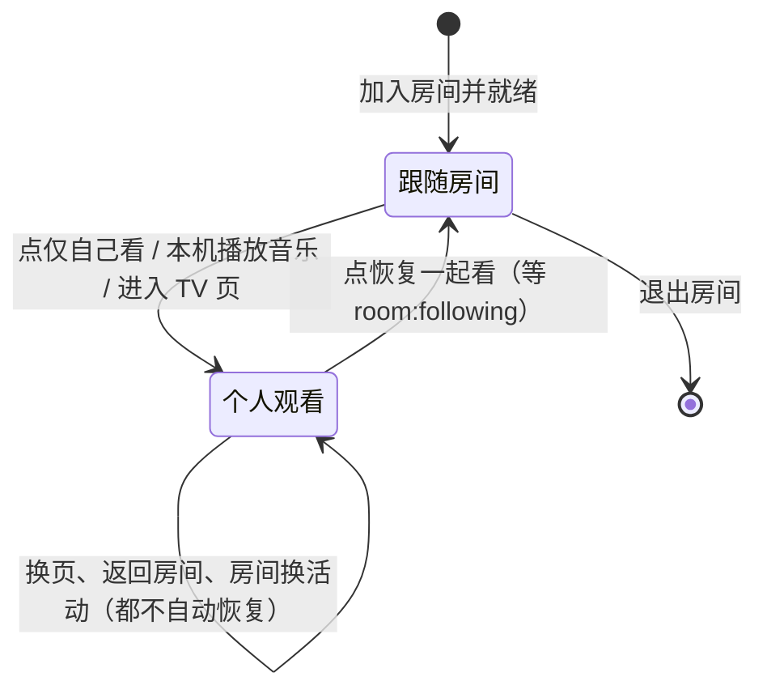

# TongMuTV Plus 怎么工作

本文说明当前改造的真实边界。需求和验收以 `requirements.md` 为准，完成程度以 `verification/` 的证据为准。设计成立、代码存在、影片真正播放成功，是三件不同的事。

## 从一次观看说起

你打开首页，先看到的是电影名称、海报、年份和介绍。这些信息叫“影片资料”，它们帮助你找片，但不代表本站已经拥有影片文件。游客只读取公开的影片资料，登录后才进入站长配置的播放来源。

你选中一部影片后，系统需要知道“哪个来源的哪部影片、哪一集”。这个组合相当于影片的取件号码。播放器用它请求详情和播放地址，再决定怎样播放。目录来源失效时可以替换来源，但不同来源的编号、集数和播放格式可能不同，不能把换一条地址当作全部兼容工作已经完成。

搜索结果已经带有简介时，海报详情直接展示这份简介，不必等另一家资料网站查询成功。片单里的「第 1 集」也必须实际播放第 1 集：房间明确集数优先于个人上次看到第几集；没有明确集数的个人观看才使用个人记录。已有片单在播放入口补上保存的集数，不为此改数据库。详见[目录接入复验](verification/browser-catalog-flow-20261009.md)。

如果拿到的是 MP4，浏览器通常直接向视频地址请求文件的一部分，边收边播放。如果拿到的是 HLS，通常会先读取 `.m3u8` 清单，再按清单请求一小段一小段的视频。地址后面的参数可能是通行凭证，因此不能为了判断扩展名而把参数丢掉。

“直连”指每个人的浏览器自己向原视频来源取片；“代理”指视频请求经过本站服务器再转交给原来源。优先直连，必要时才使用代理。代理解决的是请求怎样到达来源，不自动改善失效来源、浏览器不支持的编码或损坏的视频，也不应自动降低画质或转码。

## 一起看传递的是什么

房间主要交换影片引用、播放位置、播放/暂停、倍速和片单，通常不把房主画面再录制一遍传给所有人。服务器确认谁有主持权限，并保存房间的最新状态；每个成员的播放器各自取片、各自解码，再跟随同一条播放时间线。

“Socket.IO”是这里使用的长连接工具：网页和服务器保持联系，服务器有新消息时可以马上通知网页，不需要网页不断询问。它承载房间指令与聊天，不等于视频文件本身的传输方式。

为避免旧设备把房间倒退到旧进度，每次操作带有房间版本、主持代次和操作编号。服务器检查“你是否仍是这次主持”“你操作的是否仍是这一版房间”；重复操作不执行第二遍，过期操作被拒绝。房主回来先跟上最新进度、确认播放器准备好，再收回主持任务。

## 为什么换页面可以继续播放

普通网站经常把播放器放在播放页面里，离开该页面时，页面连同播放器一起被销毁。当前改造把播放器放到全站共同的外层，页面只负责决定它显示在哪里。

完整播放、房间内画面、小窗和折叠条，是同一个播放实例的不同显示形式。去搜索、打开收藏或收起画面，不应重新创建播放器、暂停影片或退出房间。明确换成另一部影片时，才允许更换影片对应的播放实例；失败重试也只重建媒体部分，不刷新整个网站。

这不是把两个网站互相塞进小窗口。页面之间共享的是明确的播放会话和房间状态，画面宿主保持稳定。`iframe` 是在网页里再装一个独立网页窗口；它适合某些独立工具，但如果两个窗口各有播放器、登录态和房间判断，就容易出现两份状态和两路声音。

同一浏览器多个标签页通过短期声音归属记录协调：只有一个标签页出声，另一个仍可保持画面解码和同步。它与“一个账号只有一个主持设备”是不同规则，后者由服务器决定。

## 影片、活动与房间怎样连接

先分清五件互不替代的事：**页面位置**（你在哪个页面）、**成员关系**（你是否在某个房间里）、**观看模式**（跟着房间，还是仅自己看）、**设备控制权**（这台设备此刻是不是主持，按设备算，不按账号算）、**画面形态**（完整、小窗、折叠）。普通导航只改页面位置：不换片、不退房、不恢复同步。

所有影片入口都走同一条路：把“哪部影片、哪一集、想怎么看”变成一个意图，再由全站播放会话决定。想怎么看只有三种：追加到某个房间的待看、立即一起看（主持）、仅自己看。服务器确认之前不宣布成功，回包绑定原房间和原操作编号，过期回包直接丢弃。

观看模式是一个小状态机。两个方向的切换都必须是用户的明确动作，并且等服务端确认：

房间同一时刻只有一个**活动**：电影、直播、网络直播、音乐或屏幕共享，由服务器根据命令自动切换。几条统一规则：

- **浏览不是共享**：打开直播页或音乐页只是浏览，不替整个房间切活动；必须点“在房间播放”这类明确动作才发 `live:change` / `music:change` / `screen:start`。
- **只有主持设备能发布**：发布资格是“在房间 + 跟随中 + 本设备有控制权”。普通成员可以追加待看、发聊天，不能发播放控制。
- **快照只是输入**：收到房间快照更新本机显示，不再回发新指令，避免回声。
- **每个活动页自己的刷新恢复**：没有电影实例的活动里，设备在房间页自动声明就绪，主持才能在整页刷新后回来；屏幕共享页在刷新或关闭（`pagehide`）时释放“禁止连接”标记，主持可以结束或重开遗留的共享。
- **声音归属**：同一浏览器同一时刻只有一个出声者，其他继续解码但被静音；用户显式点播放才抢声音。语音是通话，不进这个租约。
- **语音**默认关（站点配置 `ENABLE_ROOM_VOICE`），关着不监听、不申请麦克风；服务端转发不看这个配置。
- **外部观影室服务**只提供 Socket 同步，不挂载房间 REST。外部模式下目录、首页“我的房间”和恢复不再请求必败的接口，直接显示边界说明；外部服务是否兼容本站房间协议没有验证。

## 聊天为什么要单独处理

消息有长期保存的序号和每个成员的已读位置。收到消息不等于读过消息；只有聊天中实际可见的消息，且网页处于前台并有焦点时，才提交已读位置。

重新加入时，服务器先返回最新一页，网页再按离线前的记录补齐缺口；更早的记录可以继续分页加载。补到一半失败，会保留已经补到的位置，下次继续。消息序号是数据库全表序号，跨房间有空洞很正常，不能要求每个房间的序号必须相邻。

切换房间、注销或换连接后，旧请求的迟到回包会被取消，避免把甲房间的消息或已读结果写进乙房间。客户端不保存私密房间的明文密码，重连依靠服务器保存的账号成员关系。

## 目录各自负责什么

| 位置                        | 职责                                                                                                                                                                                                                                                                                                                 | 应避免承担的工作                                                                             |
| --------------------------- | -------------------------------------------------------------------------------------------------------------------------------------------------------------------------------------------------------------------------------------------------------------------------------------------------------------------- | -------------------------------------------------------------------------------------------- |
| `src/app/`                  | 页面入口、服务端接口、现有来源功能                                                                                                                                                                                                                                                                                   | 在每个页面重新管理一套长期房间和播放器                                                       |
| `src/features/playback/`    | 全站播放会话、显示形态、声音协调、旧播放器接入                                                                                                                                                                                                                                                                       | 决定谁有服务器端主持权限                                                                     |
| `src/features/rooms/`       | 房间工作区、选片、片单、邀请和设置                                                                                                                                                                                                                                                                                   | 自行判定服务端操作成功，或只靠隐藏按钮保护权限                                               |
| `src/hooks/useWatchRoom.ts` | 连接、确认回包、快照、消息补齐与去重                                                                                                                                                                                                                                                                                 | 把客户端提供的用户名当成认证凭据                                                             |
| `src/hooks/usePlaySync.ts`  | 本机播放与房间时间线之间的校准                                                                                                                                                                                                                                                                                       | 因页面卸载而替整个房间暂停或退房                                                             |
| `server/room-service.js`    | 房间规则、主持交接、权限、生命周期                                                                                                                                                                                                                                                                                   | 管理网页布局或选择浏览器的最终播放引擎                                                       |
| `server/room-store.js`      | SQLite 读写                                                                                                                                                                                                                                                                                                          | 判断界面应该显示小窗还是完整画面                                                             |
| `server/room-transport.js`  | HTTP/Socket 入口和请求校验                                                                                                                                                                                                                                                                                           | 再实现一份不同的房间规则                                                                     |
| `server/room-auth.js`       | 真实签名、账号状态与会话核对                                                                                                                                                                                                                                                                                         | 信任浏览器自报的名字、角色或旧 ownerToken                                                    |
| `scripts/ops/`              | 备份、恢复、负载演练                                                                                                                                                                                                                                                                                                 | 默认操作正式数据库或把测试结果当生产容量                                                     |
| `src/components/`           | 组件。TongMuTV 新增或重写的组件按功能域归组：`shell/`（导航、页头、返回顶部、账号入口）、`catalog/`（海报、片架、首页 Hero/房间、胶囊切换）、`feedback/`（Toast、确认框、告警框、图片查看、加载款式、移动操作表）、`account/`（主题与视觉偏好设置）；另有 `auth/ detail/ media/ music/ tv/ watch-room/` 等既有子目录 | 把上游原有组件也搬进分域目录（会放大与 MoonTVPlus 的合并冲突）；新增组件优先放进对应分域目录 |

旧播放器仍是较大的 `LegacyPlaybackSurface.tsx`，保留它是为了先保护成熟的字幕、来源处理和播放能力。把文件移动到新目录并不会自动消除内部耦合；后续拆分应以明确的行为回归为前提，逐块提取，而不是一次性重写上万行后只验证能够构建。

## 音乐、网页解析、直播与屏幕共享怎样扩展

现有功能按配置保留。未配置的入口应隐藏或给出真实的缺失说明，不能放一个按钮就宣称已经成熟。

成熟外部工具适合通过“接入层”连接：接入层把工具返回的内容整理成本站理解的影片、音乐、清单或播放信息。独立 API 服务可以单独升级和重启，但需要明确版本、认证、超时和失败提示；嵌入库更新更直接，却需要本站跟随其依赖与版本。两种方式都需要实际兼容测试。

电影网站网页解析需要另一个步骤：打开网页、找到播放器真正请求的媒体地址。无头浏览器是能运行网页但不显示普通窗口的浏览器，嗅探是观察其网络请求。无需登录只解决登录门槛，不能保证没有广告跳转、反自动化、加密播放器配置、短期签名或不兼容的视频编码。该能力保留为独立解析方向，不冒充现有 MP4/HLS 来源已经覆盖任意网页。

屏幕共享通常使用 WebRTC，把某个设备采集的屏幕实时传给其他设备；房间长连接帮助双方交换连接信息。弱网络、不同路由器或移动网络可能需要中继服务器，因此真实屏幕共享必须单独验收，不能用文字聊天成功或 50 条 Socket 连接成功来证明。

AI 推荐或总结需要实际的模型服务。自己部署网页不等于自己拥有模型算力或服务凭据；模型地址、模型名和密钥必须按所选服务配置。服务端负责调用，浏览器不应拿到站长的全局密钥。没有配置时保留明确的不可用状态，不承诺免费、无限或离线运行。

## 当前不能跳过的验证

先验证实际 MP4/HLS 解码，再验证两个账号的同步；再检查切页、小窗、折叠、断线恢复、消息已读和手机操作。单元测试帮助稳定规则，但不替代这些真实操作。容器启动、备份恢复和 50 连接信令演练也分别记录，不能互相代替。

最新证据见[实施状态](implementation-status.md)、[主持交接与消息续验](verification/browser-handoff-chat-navigation-20261009.md)和[媒体恢复与个人观看返回](verification/browser-media-recovery-20261009.md)。隔离 WSL/Linux 已实际运行，两账号 MP4/HLS 解码、连续播放、片单不换片、双标签声音、授权接管及房主返回已有浏览器证据；真实上游、后台/真机、安装与容器仍需验收，不能宣布发布完成。测试数量与当前运行边界以实施状态为准，历史批次不累加。

视频失败后的恢复入口也由全站播放层提供。原因是房间内嵌、小窗和折叠时，旧播放页的错误按钮可能被隐藏；聊天重连不会自动修好另一条视频请求。明确点击“重新加载影片”只重建本机媒体部分，再根据房间最新进度校准，不替其他成员暂停、退房或换片。

如果无人主持时影片自然结束，服务器按时间推算的进度可能超过片长。网页需要根据实际视频片长停在结尾，完成同步准备；房主接管后再提交真实暂停状态。这样不会因为反复要求播放不存在的第 156 秒而卡住主持恢复。直播或片长未知的内容不套用这个结尾判断。

### 组件目录说明

`src/components` 顶层仍保留上游 MoonTVPlus 原有组件，是有意的：大面积搬家会让后续合并全部变成改名加修改冲突。`admin/page.tsx`（禁区）直接引用 `AnimeSubscriptionComponent`、`CorrectDialog`、`DataMigration`、`PageLayout`，`usePlaySync.ts`（禁区）引用 `WatchRoomProvider`，这五个必须留在原路径。分域目录里的组件一律用 `@/components/<域>/<名>` 引用，不用相对路径。
