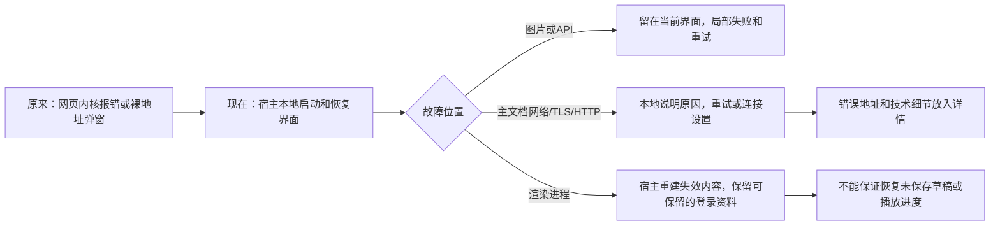
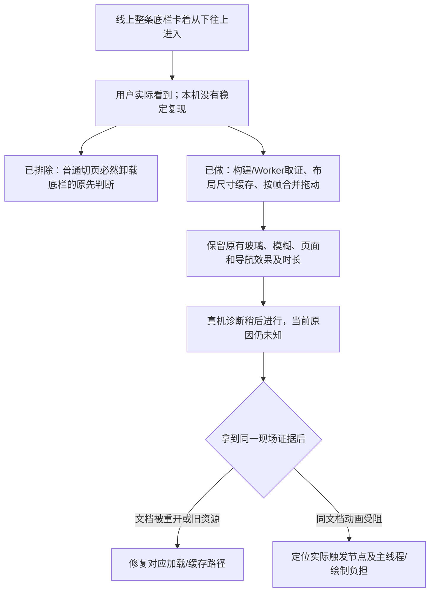
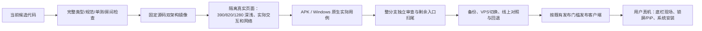

# App / Windows 当前路线图

更新：2026-11-02。这是当前摘要；逐次尝试和原始运行号保留在 PROGRESS.md。**代码存在、模拟器通过、正式用户已拿到是三个不同阶段。当前尚未完成整个优化计划。**

## 你截图里的问题，现在由谁处理

Windows x64 已验证网络、TLS、超时、渲染/浏览器进程故障及原生窗口操作；Android 已验证本地恢复，API26 以下没有同等渲染进程故障回调。它们改善“出错后怎么办”，不能保证内核永不崩溃。整个应用被系统结束时，也无法继续显示自救界面。

## 底栏：已做什么，仍缺什么

不能据此断言 VPS 导致卡顿，也不能把 rAF 采样数说成手机实际显示帧数。用户已选择稍后测试，无需重复提交信息。

## 原始问题逐项归档

编号对应最初的完整入口盘点；“待做”仍属于未完成事项，不会通过改文案或跳过失败测试变成完成。

| 原编号       | 当前处理                                                       | 验收边界 / 下一步                                                                                                                                                |
| ------------ | -------------------------------------------------------------- | ---------------------------------------------------------------------------------------------------------------------------------------------------------------- |
| W01–W07      | Windows 本地连接/故障恢复、系统窗口兜底已实现                  | x64 有实际运行；深色系统、ARM64 实机及用户设备仍待                                                                                                               |
| W08–W09      | 顶层注入与正常/故障窗口分工已有实现                            | 默认菜单、快捷键/调试版策略仍需最后核对，不全局禁止复制或合理缩放                                                                                                |
| A01–A07      | Android 本地连接、行内校验、加载与故障恢复已实现               | 旧 OS 需区分可更新 WebView 与出厂旧引擎；不能承诺 API23–25 的渲染回调能力                                                                                        |
| A08、C01–C02 | 共用外链能力分流、客户端文案与旧壳复制兜底已部分接入           | Telegram、外部播放器等剩余直接入口仍需逐个覆盖；不自动批准弹窗                                                                                                   |
| C03          | 原认证、扫码与轮询上下文保留                                   | OIDC/Telegram 客户端回跳仍待实际验证，不把认证一律丢给外部浏览器                                                                                                 |
| C04          | Windows 原生保存/进度/取消；Android 原生普通下载及新生成内容桥 | Android 新 Blob/认证 POST 在 API23/24/34 通过；旧引擎普通下载仍失败。Windows PDF 保存及默认阅读器正文已验，限完成首次引导的测试环境                              |
| C05–C07      | Android 未知来源授权返回续下、下载身份及状态已有实现           | 实际安装新 APK 待验；Windows 不冒充已有自动更新框架                                                                                                              |
| C08          | 表单现有行为保留                                               | 41424021525 三端实际浏览器验证：创建/加入空白+Enter 无 invalid/submit、无房间变更。仅据 required 判必然有气泡的前提不成立，保留原实现；FilmPicker 及其他路径未测 |
| C09–C11      | 部分平台文案、外链/复制失败反馈与能力降级已改善                | 设置、安装教学及其余异常入口仍待扫尾，旧版壳不能只改名假装支持                                                                                                   |
| C12          | 保留现有 PDF iframe 和 EPUB 引擎，已改善导出/保存入口          | 全面重写阅读器另立方案；缩放、搜索、无障碍和大文件成本不能省略                                                                                                   |
| C13–C14      | 保留既有主播放器、必要系统控件、输入和聊天复制                 | 不以“像 App”为由破坏视频单例、字幕、键盘操作或粘贴                                                                                                               |
| C15          | 产品源码盘点未发现直接 JS alert/confirm/prompt                 | 不为未出现的问题全局替换同步 API；外部/遗留页面兜底单独核对                                                                                                      |
| C16–C17      | 保留现有页面错误/404 和统一 Select                             | 页面错误不接管宿主进程崩溃；不重复改造已统一的控件                                                                                                               |
| C18          | 文件选择、通知与媒体控制部分已接入系统能力                     | 相机、语音、屏幕等按实际支持分别处理允许/拒绝/取消，尚未全覆盖                                                                                                   |
| S01–S02      | 保留安装器、UAC/SmartScreen、系统 PiP/通知和应用选择           | 不伪造系统确认；签名/发布信誉是独立成本，CSS 无法消除这些系统界面                                                                                                |

## 接下来如何验收和交付

最近新增的搜索工具局部刷新已过本机 typecheck/lint、186 套 1224 项测试及 27 项房间回归；固定源 ac92cd8 的 41421317932 完整镜像流程通过，41422837112 实际触摸、失败保留、真实网络中止和平台隔离全部通过，12 张三宽深浅截图已实看。网页和 Windows 不注册 App 下拉刷新，保留文档；上游查询/功能旗标及壳标记为受控测试，不代表手机实际帧呈现。全仓库本机格式仍仅受原未知未跟踪 NUL 文档影响，干净 CI 完整格式已通过。

Windows 默认系统 PDF 阅读器在已配置 Edge 环境通过，强化后的 41423233425 还验证无瞬时用户激活的自动弹窗不产生立即或迟到外部请求；同一 742d1ff 原生包未改，未重复编译发布。原生保存和阅读器来自实际系统，不是浏览器模拟桥；仍仅 x64 浅色系统及固定安全 PDF，不代表 EPUB、任意第三方阅读器或用户机器。

正式 VPS 仍为 c28ab11b。新 APK/EXE 尚未发布。发布时保留旧镜像、配置和静态资源，在线备份数据库；代码回退不覆盖发布后的用户数据。
