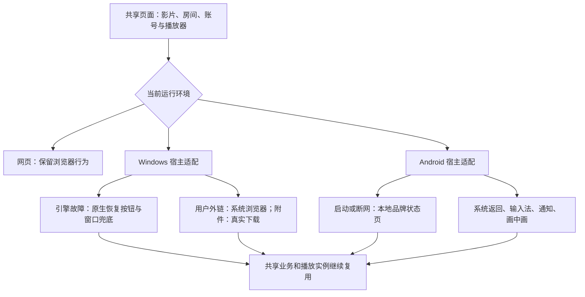
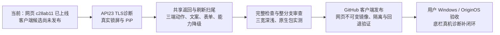

# 客户端体验：当前证据与后续路线

更新时间：2026-11-01。此文件区分“代码已做”“测试已过”“用户已拿到”，不将三者混为完成。原始盘点 W/A/C/S 编号仍保留在只读审计中。

## 从哪里改，为什么不需要重写三端

## 已有证据和还差什么

| 表面                         | 原先表现                                   | 当前有证据的改善                                                                                                                   | 尚未完成或不能保证                                                                     |
| ---------------------------- | ------------------------------------------ | ---------------------------------------------------------------------------------------------------------------------------------- | -------------------------------------------------------------------------------------- |
| Windows 主页面/引擎故障      | 内核自带“此页存在问题”，网页按钮也可能失效 | 宿主原生恢复，区分网络、TLS、超时、renderer 与 browser；故障时系统窗口控件兜底                                                     | 没有证明消除所有 STATUS_ACCESS_VIOLATION；用户机器待验                                 |
| Windows 外链、附件           | 新窗口默认被拒绝；下载可能误报连接中断     | cbee5dd 双架构完整非发布构建通过；真实 HTTP 外链交系统浏览器、保留原文档、拒绝自动弹窗；默认附件实际保存通过                       | ARM64 仅构建，尚无实际运行；磁力/Blob/另存为界面不在已验范围                           |
| Windows 配置/登录资料        | 故障后是否保留不明确                       | 实际保存服务器，正常重开、renderer 恢复、browser 重启后地址及一次设置的持久 HttpOnly Cookie 保留                                   | 哨兵 Cookie 不是所有真实账号/过期令牌/未保存草稿的证明                                 |
| Android 启动、连接故障       | 系统默认弹窗、裸地址、黑底                 | API23/24/34 本地品牌状态页、HTTP/TLS/重试/设置/返回通过；API34 显示进程终止后同宿主恢复通过                                        | API23–25 没有 renderer 故障宿主回调；系统结束整个应用后无法继续绘制                    |
| Android 更新                 | 从未知来源授权返回可能丢失更新意图         | 授权拒绝不下载、允许后原请求只续一次、下载身份核对已在 API34 通过                                                                  | 没有实际安装新 APK；系统安装确认应保留                                                 |
| 系统媒体控制                 | 通知直接暂停 DOM，网页元数据依赖页面标题   | ca4b0fa 的 API34 实际单一原生会话/片名/后台暂停恢复/权限锁定/媒体移除清理通过；完整 Checks 与 176 套 1146 项单测通过               | API23 TLS 仍待诊断；真实锁屏界面、PiP 与用户手机未验，未发布 APK                       |
| App 局部刷新、栏目记忆、键盘 | 部分依赖整页刷新或切页丢状态               | 四个一级页实际局部刷新与媒体单例已验；8fef3d1 生产候选在 1440→390 真实触摸刷新、变宽取消、重新启用、503 保留列表及三宽深浅截图通过 | 首页附属模块/子工具刷新仍有欠缺；模拟壳标记与测试资料不等于 OriginOS 真机              |
| 整条底栏卡着向上进入         | 用户 iQOO 真机与线上可见，本机未复现       | c28ab11 已部署：构建/Worker 取证、按帧拖动、布局读取缓存、拖动后下一次点按修正                                                     | 原因仍未知；rAF 不等于实际 GPU 呈现。用户选择稍后给真机诊断，不能声称 VPS 或手机已修好 |

## 下一步验收路径

系统文件选择、权限、安装器、分享/外部应用选择界面应保持系统拥有。客户端适配改善入口说明、取消/失败反馈与返回流程；不应伪造系统确认。网络不可用时可以提供可操作的本地恢复界面，不能把远程服务变成离线可用；引擎或操作系统结束宿主时，也不能承诺应用持续播放。

Windows 主要验证：[41280022405](https://github.com/XYL333FYQ/TongMuTVPlus/actions/runs/41280022405)。网页媒体桥完整检查：[41281046590](https://github.com/XYL333FYQ/TongMuTVPlus/actions/runs/41281046590)。Android 通知红测：[41281047653](https://github.com/XYL333FYQ/TongMuTVPlus/actions/runs/41281047653)。后续结果以 PROGRESS.md 与执行计划中的最新追加记录为准。
