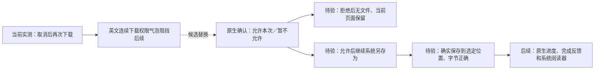
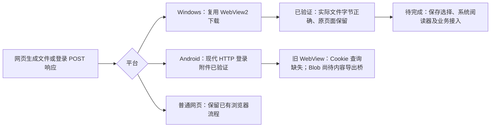
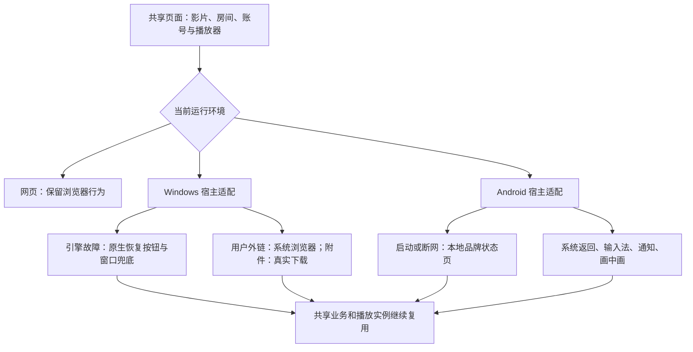
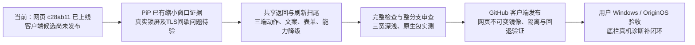
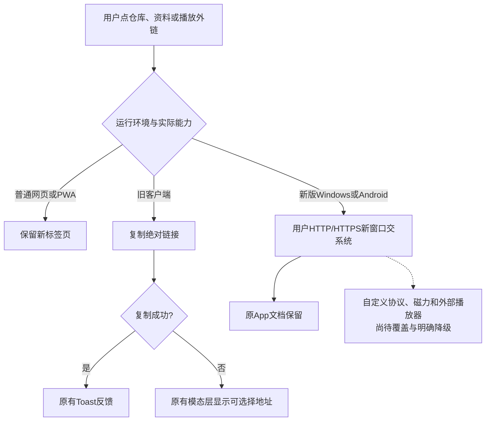
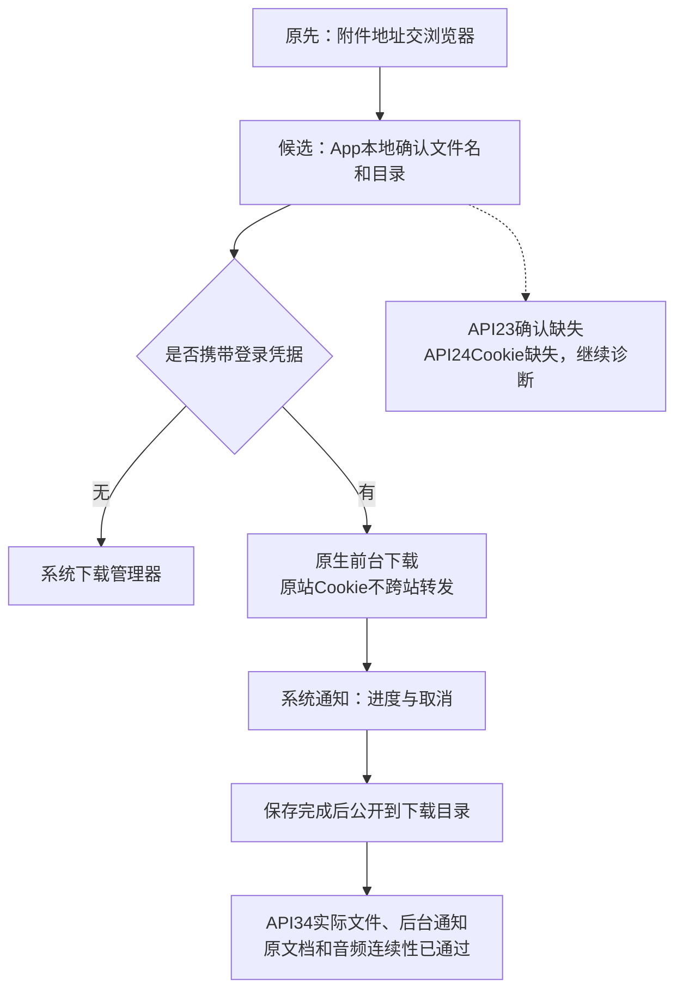

# 客户端体验：当前证据与后续路线

更新时间：2026-11-01。此文件区分“代码已做”“测试已过”“用户已拿到”，不将三者混为完成。原始盘点 W/A/C/S 编号仍保留在只读审计中。

## 最新验收边界

最新 Windows 候选为 28563e7：0902915 的完整检查、双架构编译、安装/便携已通过，实际下载测试被英文连续下载权限气泡拦住，未再进入整页错误 9，但也没有执行正向另存为，不能说位置已经修好。已实看该浏览器提示，新候选只将这一权限换成原生“允许本次／暂不允许”，默认拒绝，来源只显示 origin，使用引擎非持久状态，不放开其他权限。格式/策略已通过，完整构建 41337444547 与 Checks41337441345 进行中；原生拒绝、重试允许、选定路径及文件内容仍待实际验收。原生进度、完成反馈与阅读器仍是发布前必需项。

前一候选 2eb9c84 曾在网页构建页面收集阶段遇到 SQLITE_BUSY，类型/测试此前通过；没有修改数据库代码，当前 0902915 完整检查通过也不等于该锁错误根因已定位。该失败日志保留，未因此跳过构建门禁。

**Windows 原生“另存为”仍未验收通过。** 已实看系统对话框并验证取消/原文档保留，但不能把默认目录文件代替选定位置。53d0dcf 调整最终取消决策并加入路径读回后仍失败；9ddfcbf/41333729492 的磁盘证据明确为默认目录 30 字节、选定目录缺失。555139b/41334200500 的无活动 CDP、OS 辅助功能可信点击对照还触发连接中止错误 9，不能只归因调试器。最新 0902915 改由宿主接管保存选择，当前导航同地址的成功 attachment 响应提前确认；策略/格式已过，完整双架构 41335519213 及 Checks41335517044 正在运行，实际路径、故障恢复仍待验收。默认下载 UI 接管后，原生进度/取消/完成与系统阅读器必须补齐才可发布；当前无新客户端发布或 VPS 改变。没有新增依赖/网页文件系统命令，此边界与下方“旧包引擎能保存 Blob”证据分开。

Windows 文件补证（9b979fd）：非发布审计 41329814384 通过，严格匹配 8cc95c5 原生/UI/包源与原成功双架构构建；本轮实际运行仍只证明 x64，`releaseEligible=false`。真实点击生成 Blob 和带 HttpOnly/SameSite 登录的 POST 响应转 Blob，未覆盖 WebView2 下载行为，分别保存 29/33 字节，包含 NUL 和中文；磁盘字节、同文档及认证请求精确一次均通过。文件 SHA256 分别为 `039DFF7CBCAB29B64D3C7B12C15B4256183B45DA954E2F465C08EAB4F5FAA6C9`、`9E1B6BDF6CD9B2002790226DF8217003770E63DEB8C2F13B1BF2980E52B46555`。两张截图已实看，日志/文件在 `output/client-experience/windows-blob-9b979fd`。这证明引擎能保存这两类文件，不证明书籍业务、原生另存对话框、默认阅读器打开或互联网文件标记已验收。

首轮 6c98f20/41329523504 已保存文件但中文乱码，原因是 CI HTML 未声明 UTF-8，源文本被错误解码后才生成 Blob；修正夹具 charset 后，同一客户端包通过。没有修改产品下载器、放宽字节断言或删除失败记录。

- 完整 Checks41326584847 通过；Android41326586775 的 APK 与 API34 通过，API23/24 失败，Release 跳过。正式网页仍 c28ab11，未发布新客户端。
- API34 首载夹具包含紧邻播放/停止，随后完成媒体会话、后台控制、实际 192×108 画中画及返回、登录附件后台下载和保存字节核对；日志没有本应用 fatal。此前服务启动被立即撤销导致的崩溃本轮未再出现，只能据此确认该回归场景通过，不能保证所有设备永不崩溃。
- API24 在用户确认和存储权限处理之前的下载回调中已经 `cookie=false`，之后同服务器仍为 `sourceCookie=false`；网页探针可带登录 Cookie。这排除了“只是权限弹窗把凭据清掉”的解释，符合旧 Chromium Cookie 查询对 SameSite 的限制。API23 仍未出现下载确认，不能称普通下载已兼容全部最低系统。
- 接下来应让网页按原有鉴权取得文件响应，再将受控文件内容交给原生保存，并覆盖 Blob/书籍文件。不得删 SameSite、修改登录接口或把 Cookie 发给外站来通过测试。Windows 先验证 WebView2 自带 Blob 下载，再决定是否需要补宿主接口。
- 证据在 `output/client-experience/android-stability-113cd9c/` 与 `client-stability-ci.log`。已实看 API34 下载确认、后台通知、缩小 PiP 截图。它们是模拟器和测试媒体证据，不能替代 OriginOS 真机、业务播放器或用户底栏验收。用户选择稍后测试，底栏原因仍未知。

## 从哪里改，为什么不需要重写三端

## 已有证据和还差什么

| 表面                         | 原先表现                                   | 当前有证据的改善                                                                                                                        | 尚未完成或不能保证                                                                     |
| ---------------------------- | ------------------------------------------ | --------------------------------------------------------------------------------------------------------------------------------------- | -------------------------------------------------------------------------------------- |
| Windows 主页面/引擎故障      | 内核自带“此页存在问题”，网页按钮也可能失效 | 宿主原生恢复，区分网络、TLS、超时、renderer 与 browser；故障时系统窗口控件兜底                                                          | 没有证明消除所有 STATUS_ACCESS_VIOLATION；用户机器待验                                 |
| Windows 外链、附件           | 新窗口默认被拒绝；下载可能误报连接中断     | cbee5dd 双架构完整非发布构建通过；真实 HTTP 外链交系统浏览器、保留原文档、拒绝自动弹窗；默认附件实际保存通过                            | ARM64 仅构建，尚无实际运行；磁力/Blob/另存为界面不在已验范围                           |
| Windows 配置/登录资料        | 故障后是否保留不明确                       | 实际保存服务器，正常重开、renderer 恢复、browser 重启后地址及一次设置的持久 HttpOnly Cookie 保留                                        | 哨兵 Cookie 不是所有真实账号/过期令牌/未保存草稿的证明                                 |
| Android 启动、连接故障       | 系统默认弹窗、裸地址、黑底                 | API23/24/34 本地品牌状态页、HTTP/TLS/重试/设置/返回通过；API34 显示进程终止后同宿主恢复通过                                             | API23–25 没有 renderer 故障宿主回调；系统结束整个应用后无法继续绘制                    |
| Android 更新                 | 从未知来源授权返回可能丢失更新意图         | 授权拒绝不下载、允许后原请求只续一次、下载身份核对已在 API34 通过                                                                       | 没有实际安装新 APK；系统安装确认应保留                                                 |
| 系统媒体控制                 | 通知直接暂停 DOM，网页元数据依赖页面标题   | 0f9623e 的 API23/24/34 流程及 API34 实际单一原生会话/片名/后台暂停恢复/权限锁定/媒体移除清理通过；完整 Checks 与 176 套 1146 项单测通过 | API23 TLS 间歇等待未再现但根因不明；真实锁屏界面与用户手机未验，未发布 APK             |
| App 局部刷新、栏目记忆、键盘 | 部分依赖整页刷新或切页丢状态               | 四个一级页实际局部刷新与媒体单例已验；8fef3d1 生产候选在 1440→390 真实触摸刷新、变宽取消、重新启用、503 保留列表及三宽深浅截图通过      | 首页附属模块/子工具刷新仍有欠缺；模拟壳标记与测试资料不等于 OriginOS 真机              |
| 整条底栏卡着向上进入         | 用户 iQOO 真机与线上可见，本机未复现       | c28ab11 已部署：构建/Worker 取证、按帧拖动、布局读取缓存、拖动后下一次点按修正                                                          | 原因仍未知；rAF 不等于实际 GPU 呈现。用户选择稍后给真机诊断，不能声称 VPS 或手机已修好 |

## 下一步验收路径

系统文件选择、权限、安装器、分享/外部应用选择界面应保持系统拥有。客户端适配改善入口说明、取消/失败反馈与返回流程；不应伪造系统确认。网络不可用时可以提供可操作的本地恢复界面，不能把远程服务变成离线可用；引擎或操作系统结束宿主时，也不能承诺应用持续播放。

Windows 主要验证：[41280022405](https://github.com/XYL333FYQ/TongMuTVPlus/actions/runs/41280022405)。网页媒体桥完整检查：[41281046590](https://github.com/XYL333FYQ/TongMuTVPlus/actions/runs/41281046590)。Android 通知红测：[41281047653](https://github.com/XYL333FYQ/TongMuTVPlus/actions/runs/41281047653)。后续结果以 PROGRESS.md 与执行计划中的最新追加记录为准。

## 2026-11-01 补充验收

| 项目             | 本次实际证据                                                                                                                                       | 边界                                                                                    |
| ---------------- | -------------------------------------------------------------------------------------------------------------------------------------------------- | --------------------------------------------------------------------------------------- |
| Android PiP      | 909e427 / Android41297279181 第 2 次 API23/24/34 全绿；API34 实际 192×108 窗口覆盖 320×640 桌面，同视频同文档暂停、恢复、回全屏通过                | 官方测试片、模拟器；未证明 OriginOS、关闭 PiP 清理或真实锁屏；首次 API34 启动超时仍保留 |
| Windows 窗口动作 | b1bfef8 / audit41298500045 与 Checks41298498565 全绿；实际最大化/还原/最小化、F11 文档及系统全屏，同文档保持                                       | 复用严格输入相同的 cbee5dd 包，只是非发布复验；最小化由测试主动恢复，ARM64 无运行证据   |
| 手动局部刷新     | 909e427 / Checks41297277379、镜像 41297825887；隔离浏览器深浅三宽 12 图，失败只提示一次、旧内容保留、离开实际取消 HTTP、手动日历重新请求并更新缓存 | 测试元数据及模拟壳标记，不代表真实来源永远可用，不是手机帧呈现证明                      |

隔离 909e427 测试容器已关闭；正式网页仍 c28ab11，健康正常。新 APK/EXE 尚未发布。接下来完成 Android 外链和下载、共享返回及跨端动作/表单/安装说明，再进入整分支验收。

## 外链：网页习惯如何转换为客户端动作

Android 实际红测确认原新窗口在 WebView 内替换主页面；e8b24d3 修复后，API34 真实链接交 Chrome 且同原文档返回，API23/24/34 整套恢复流程通过。Chrome 停在首次启动向导，只证明系统交接，未证明目标网页已加载。对应[Android 验证 41302306587](https://github.com/XYL333FYQ/TongMuTVPlus/actions/runs/41302306587)。框架默认行为与入口约束见[Android WebSettings](<https://developer.android.com/reference/android/webkit/WebSettings#setSupportMultipleWindows(boolean)>)及[WebChromeClient](<https://developer.android.com/reference/android/webkit/WebChromeClient#onCreateWindow(android.webkit.WebView,boolean,boolean,android.os.Message)>)。

Windows8cc95c5 已完整重建双架构，并通过 x64 安装/便携、能力声明、实际窗口/外链/下载/故障恢复；[Windows 验证 41302471462](https://github.com/XYL333FYQ/TongMuTVPlus/actions/runs/41302471462)。共享动作及复制弹层的新一批通过 179 套 1171 项单测，真实页面视觉仍待最终候选验收。**以上均未发布新客户端；普通下载、自定义协议、共享返回/刷新及跨端表单/安装说明仍未做完。**

## 普通下载当前状态：现代系统通过，旧系统尚未通过

1ed573e 的[完整检查 41321017855](https://github.com/XYL333FYQ/TongMuTVPlus/actions/runs/41321017855)通过；[Android41321019799](https://github.com/XYL333FYQ/TongMuTVPlus/actions/runs/41321019799)只有 APK 和 API34 通过，整支仍失败。已实看下载确认、桌面后台进度、完成通知和返回原页面的四张截图，实际下载文件内容正确；不能把 API34 结果扩大为所有 Android 系统或 OriginOS 真机。

登录附件不直接把 Cookie 交给系统下载器：AOSP 实现会在重定向循环中复用显式请求头，见[DownloadThread 源码](https://raw.githubusercontent.com/aosp-mirror/platform_packages_providers_downloadprovider/master/src/com/android/providers/downloads/DownloadThread.java)。候选按原站点约束凭据传输，且有真实跨主机重定向、截断、取消和错误响应测试；普通公开文件仍复用系统下载器。认证任务被系统结束后暂不自动续传，Blob 导出/阅读器与自定义协议仍待完成。尚未发布 APK。
