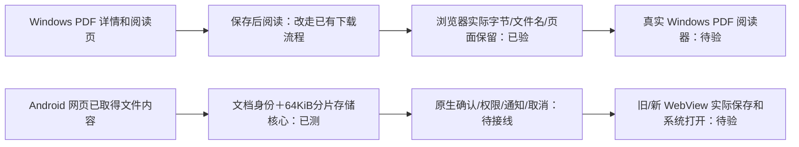
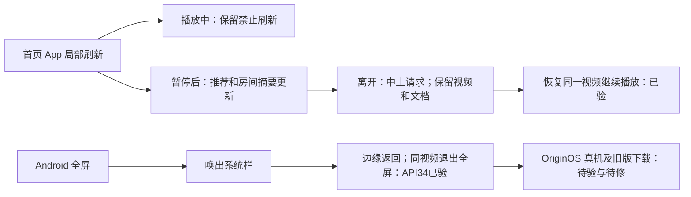
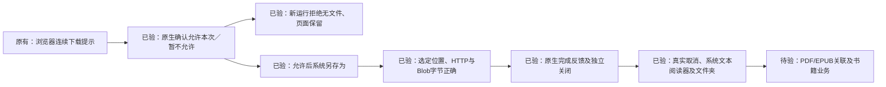
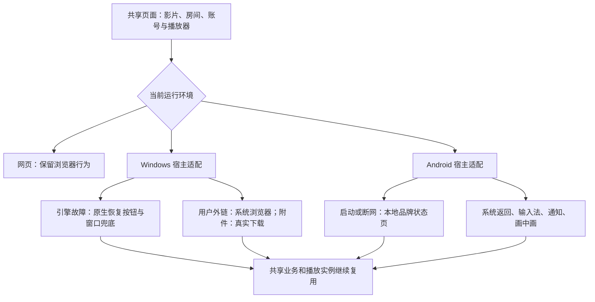
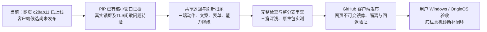
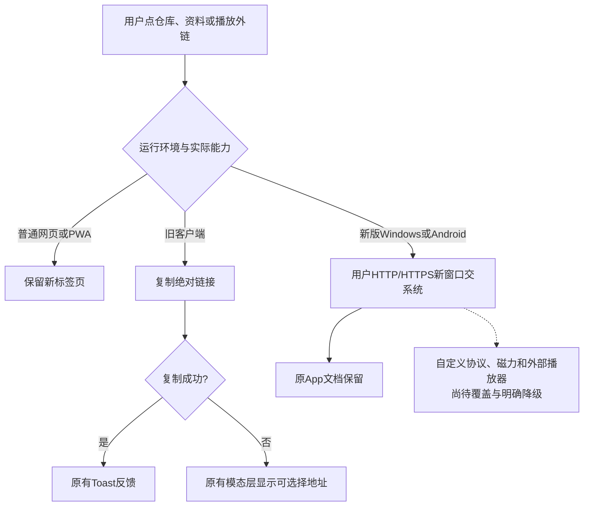
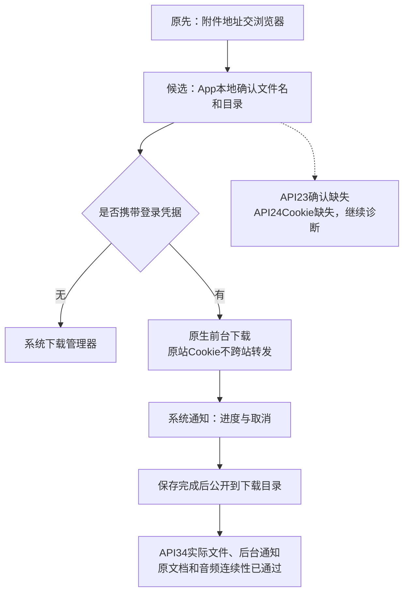

# 客户端体验：当前证据与后续路线

更新时间：2026-11-01。此文件区分“代码已做”“测试已过”“用户已拿到”，不将三者混为完成。原始盘点 W/A/C/S 编号仍保留在只读审计中。

## 最新验收边界

书籍最新（取代下文撤回/未运行的历史）：用户继续目标后，5ea10d9 修正 Windows 详情 PDF 和阅读页 Blob 新窗口入口，沿用既有 WebView2 下载、原生另存/完成窗口的显式阅读器动作；网页/App 入口及 PDF iframe 保留。本机 type/lint、184 套 1202 项、房间 27 通过，来源 41401049805 的干净完整 checks、双架构镜像及合并成功。固定镜像 digest=9671f96a11b6c7bdd1c2afb381243214885cf44da8228959b1de5d517dc44388。

dd51783/41402507438 的隔离真实页面验收成功：详情一次 POST 的文件名/PDF 确切字节，阅读页复用已有 Blob 而不重复请求，原文档/iframe 保留，web/app 既有入口保留，390/820/1280 深浅六图已实看、无横向溢出。夹具 PDF 为 596 字节，SHA256=97444fdbfea671938c8cf7415766427714637cc2ad49401350b3c1e09c332d03。使用模拟壳标记/受控 API/禁用 Worker；`nativeOsReaderTested=false`，不证明真实 Windows PDF 默认关联、业务书源或原生点击已通过，未部署或发布。

Android 内容导出 dd51783 仅完成私有有界分片存储核心，精确字节及身份/顺序/大小/超时/取消正反测试通过；尚未接网页桥、用户确认、原生存储/通知/取消入口，API23/24 下载缺口依然存在。

当前终态（优先于下文历史）：首页 0cfd99e 双架构镜像 41372954935 已完成；2431d12 的隔离浏览器验收 41378835412 成功，真实触摸验证两主题刷新两模块、失败保留与单提示、离开时两 HTTP 中止及迟到不写缓存、播放中禁止刷新、暂停刷新后同一视频恢复且时间继续。390/820/1280 深浅六图已实看，无横向溢出；普通网页/Windows 真实下拉不触发 App 刷新，原文档保留。使用受控数据、模拟壳标记且禁用 Worker，不代表实际 APK 或线上缓存/性能已验收。来源镜像 digest 为 d75bb93e4efba24912007e3f9ddbbbe313e427316d8f819f676760e43d943a44，正式 VPS 未部署此镜像。

Android 3f32ae9/41378149415：APK 构建成功，API34 整套模拟器成功，完整 Checks41378147393 成功；真实返回、媒体/PiP/退出全屏、外链、下载等通过。全屏退出图已实看；先唤出沉浸系统栏再执行真实边缘返回，不用 JS 或按键代替。API23/24 仍分别缺少下载确认/下载进度，整条 workflow 失败、发布跳过，不能称最低版本已兼容。测试为受控桥夹具，不代表实际 React 层级或 OriginOS 真机已验。用户手机底栏诊断仍待其稍后进行，不据模拟器通过判定帧数/根因。

以下为历史记录；其中“构建中/运行中/尚未进行”的旧状态由以上终态替代。Windows PDF 书籍入口候选的行为单测曾通过 6 项，但最终类型检查发现新增测试的 TS2683 三处；已按 AGENTS 规则撤回本批 page/helper/test 并停止实现，书籍问题尚未修复。完整 Checks41378833969 成功对应撤回候选之前的已提交首页验收脚本版本，不是这次书籍候选的通过证据。

首页附属刷新 0cfd99e：推荐轮播和私人房间摘要已接入既有 App 局部刷新，网页/Windows 保留原入口；刷新等待/失败保留内容，离开会中止，旧响应不能覆盖新结果，账户变化不发布旧摘要，手动刷新期间暂停摘要轮询。新增及既有定向 37 项、本地类型/lint、完整 182 套 1193 项及 27 项房间测试通过；本地全仓格式仅未知未跟踪全 NUL 文档失败，干净审计镜像流程 41372954935 内的完整 checks 已通过。双架构镜像仍在构建，真实三宽深浅、网络取消和媒体单例验收尚未进行；正式服务未改，不能称效果验收完成。推荐接口既有服务端缓存保留。

Android 返回最新补证：7ce0aac/41372618188 的 API34 在真实系统导航窗口存在后，边缘滑动完成先关浮层再退 SPA 历史，原文档/PID 保留；API23/24 返回键先前亦通过。API34 媒体控制及 192×108 PiP 同视频暂停/恢复/回全屏也通过，最终被系统首次全屏引导挡住退出检查，整支仍失败。仅 CI 增量 b3c7957 用系统资源 ID 处理该引导、保留真实手势退出及播放断言，运行 41373660355/Checks41373657729 中；产品返回和播放器逻辑未改，旧系统下载及真实 React 多层优先级、OriginOS 仍未验收。下方较早运行状态仅作历史。

Windows 原生进度候选 742d1ff：完整运行 41369538858 和 Checks41369536779 均通过。双架构编译、安装/便携通过；x64 实际验证原生进度/完成/独立关闭、主窗口可操作、取消中断真实连接、取消后禁用文件操作、默认系统阅读器显示选定文本、Explorer 打开确切目录，以及既有保存/权限/故障恢复，四张新增截图已实看。普通网页及正式 VPS 未改变，客户端未发布；仅系统浅色 x64 实操，ARM64 无运行证明。阅读器实测为 .txt，不等于真实 PDF/EPUB 关联、书籍业务或互联网文件标记已验证。

Android 返回链补证 ad47b9d：完整 Checks41370151750 通过，模拟器整支 41370153962 失败。API23/24 的系统返回键已验证先关浮层再退 SPA 历史，原文档与宿主 PID 保留；后续旧下载问题仍在。API34 的系统手势模式及触屏输入已确认，但边缘滑动未触发宿主网页回调，尚未判定系统识别还是客户端接入；仅测试诊断增量 9549b47 的 41370909946 正在运行，产品返回逻辑未改。这里使用受控桥夹具，不代表真实 React 各层优先级或 OriginOS 真机已验收。

Windows 原生候选 28563e7 的双架构编译、安装/便携及完整检查已通过。使用来源匹配的同一包，f2ba8b3 的隔离 x64 验证 41367260323 已通过：系统另存为取消、普通附件及生成/认证 POST Blob 保存到选定位置、确切字节、默认目录无副本、原文档保留；明确允许后正常关闭重开，再次出现原生权限确认，拒绝后无新文件且旧文件不变、Cookie 保留。HTTP/TLS/断网/超时/渲染器及浏览器进程退出恢复亦通过。本轮完整 Checks41367257922 已通过；无新发布或 VPS 部署。ARM64 仍仅编译证明；进度、完成与系统文件操作的最新结果见上段。

前一候选 2eb9c84 曾在网页构建页面收集阶段遇到 SQLITE_BUSY，类型/测试此前通过；没有修改数据库代码，当前 0902915 完整检查通过也不等于该锁错误根因已定位。该失败日志保留，未因此跳过构建门禁。

此前保存失败的归因已更正：UIA 写入文件名/Invoke 保存按钮虽显示新文字，实际落到默认路径；改用系统键盘和鼠标后，同一 28563e7 包保存位置正确。辅助点击实测 trusted=true 且 activeAtClick=true，不能要求其必然无瞬时激活，也不能把该断言失败误报为页面替换。失败证据保留，最终证据在 `output/client-experience/windows-input-proof-f2ba8b3`。这只证明本轮实际覆盖的原生保存和权限流程，未证明业务书籍、默认阅读器或互联网文件标记。默认下载 UI 已接管，这一历史约束已由上方 742d1ff 的实际用例补证；正式发布仍须完成整批验收。

Windows 文件补证（9b979fd）：非发布审计 41329814384 通过，严格匹配 8cc95c5 原生/UI/包源与原成功双架构构建；本轮实际运行仍只证明 x64，`releaseEligible=false`。真实点击生成 Blob 和带 HttpOnly/SameSite 登录的 POST 响应转 Blob，未覆盖 WebView2 下载行为，分别保存 29/33 字节，包含 NUL 和中文；磁盘字节、同文档及认证请求精确一次均通过。文件 SHA256 分别为 `039DFF7CBCAB29B64D3C7B12C15B4256183B45DA954E2F465C08EAB4F5FAA6C9`、`9E1B6BDF6CD9B2002790226DF8217003770E63DEB8C2F13B1BF2980E52B46555`。两张截图已实看，日志/文件在 `output/client-experience/windows-blob-9b979fd`。这证明引擎能保存这两类文件，不证明书籍业务、原生另存对话框、默认阅读器打开或互联网文件标记已验收。

首轮 6c98f20/41329523504 已保存文件但中文乱码，原因是 CI HTML 未声明 UTF-8，源文本被错误解码后才生成 Blob；修正夹具 charset 后，同一客户端包通过。没有修改产品下载器、放宽字节断言或删除失败记录。

- 完整 Checks41326584847 通过；Android41326586775 的 APK 与 API34 通过，API23/24 失败，Release 跳过。正式网页仍 c28ab11，未发布新客户端。
- API34 首载夹具包含紧邻播放/停止，随后完成媒体会话、后台控制、实际 192×108 画中画及返回、登录附件后台下载和保存字节核对；日志没有本应用 fatal。此前服务启动被立即撤销导致的崩溃本轮未再出现，只能据此确认该回归场景通过，不能保证所有设备永不崩溃。
- API24 在用户确认和存储权限处理之前的下载回调中已经 `cookie=false`，之后同服务器仍为 `sourceCookie=false`；网页探针可带登录 Cookie。这排除了“只是权限弹窗把凭据清掉”的解释，符合旧 Chromium Cookie 查询对 SameSite 的限制。API23 仍未出现下载确认，不能称普通下载已兼容全部最低系统。
- 接下来应让网页按原有鉴权取得文件响应，再将受控文件内容交给原生保存，并覆盖 Blob/书籍文件。不得删 SameSite、修改登录接口或把 Cookie 发给外站来通过测试。Windows 先验证 WebView2 自带 Blob 下载，再决定是否需要补宿主接口。
- 证据在 `output/client-experience/android-stability-113cd9c/` 与 `client-stability-ci.log`。已实看 API34 下载确认、后台通知、缩小 PiP 截图。它们是模拟器和测试媒体证据，不能替代 OriginOS 真机、业务播放器或用户底栏验收。用户选择稍后测试，底栏原因仍未知。

## 从哪里改，为什么不需要重写三端

## 已有证据和还差什么

| 表面                         | 原先表现                                   | 当前有证据的改善                                                                                                                        | 尚未完成或不能保证                                                                     |
| ---------------------------- | ------------------------------------------ | --------------------------------------------------------------------------------------------------------------------------------------- | -------------------------------------------------------------------------------------- |
| Windows 主页面/引擎故障      | 内核自带“此页存在问题”，网页按钮也可能失效 | 宿主原生恢复，区分网络、TLS、超时、renderer 与 browser；故障时系统窗口控件兜底                                                          | 没有证明消除所有 STATUS_ACCESS_VIOLATION；用户机器待验                                 |
| Windows 外链、附件           | 新窗口默认被拒绝；下载可能误报连接中断     | cbee5dd 双架构完整非发布构建通过；真实 HTTP 外链交系统浏览器、保留原文档、拒绝自动弹窗；默认附件实际保存通过                            | ARM64 仅构建，尚无实际运行；磁力/Blob/另存为界面不在已验范围                           |
| Windows 配置/登录资料        | 故障后是否保留不明确                       | 实际保存服务器，正常重开、renderer 恢复、browser 重启后地址及一次设置的持久 HttpOnly Cookie 保留                                        | 哨兵 Cookie 不是所有真实账号/过期令牌/未保存草稿的证明                                 |
| Android 启动、连接故障       | 系统默认弹窗、裸地址、黑底                 | API23/24/34 本地品牌状态页、HTTP/TLS/重试/设置/返回通过；API34 显示进程终止后同宿主恢复通过                                             | API23–25 没有 renderer 故障宿主回调；系统结束整个应用后无法继续绘制                    |
| Android 更新                 | 从未知来源授权返回可能丢失更新意图         | 授权拒绝不下载、允许后原请求只续一次、下载身份核对已在 API34 通过                                                                       | 没有实际安装新 APK；系统安装确认应保留                                                 |
| 系统媒体控制                 | 通知直接暂停 DOM，网页元数据依赖页面标题   | 0f9623e 的 API23/24/34 流程及 API34 实际单一原生会话/片名/后台暂停恢复/权限锁定/媒体移除清理通过；完整 Checks 与 176 套 1146 项单测通过 | API23 TLS 间歇等待未再现但根因不明；真实锁屏界面与用户手机未验，未发布 APK             |
| App 局部刷新、栏目记忆、键盘 | 部分依赖整页刷新或切页丢状态               | 四个一级页实际局部刷新与媒体单例已验；8fef3d1 生产候选在 1440→390 真实触摸刷新、变宽取消、重新启用、503 保留列表及三宽深浅截图通过      | 首页附属模块/子工具刷新仍有欠缺；模拟壳标记与测试资料不等于 OriginOS 真机              |
| 整条底栏卡着向上进入         | 用户 iQOO 真机与线上可见，本机未复现       | c28ab11 已部署：构建/Worker 取证、按帧拖动、布局读取缓存、拖动后下一次点按修正                                                          | 原因仍未知；rAF 不等于实际 GPU 呈现。用户选择稍后给真机诊断，不能声称 VPS 或手机已修好 |

## 下一步验收路径

系统文件选择、权限、安装器、分享/外部应用选择界面应保持系统拥有。客户端适配改善入口说明、取消/失败反馈与返回流程；不应伪造系统确认。网络不可用时可以提供可操作的本地恢复界面，不能把远程服务变成离线可用；引擎或操作系统结束宿主时，也不能承诺应用持续播放。

Windows 主要验证：[41280022405](https://github.com/XYL333FYQ/TongMuTVPlus/actions/runs/41280022405)。网页媒体桥完整检查：[41281046590](https://github.com/XYL333FYQ/TongMuTVPlus/actions/runs/41281046590)。Android 通知红测：[41281047653](https://github.com/XYL333FYQ/TongMuTVPlus/actions/runs/41281047653)。后续结果以 PROGRESS.md 与执行计划中的最新追加记录为准。

## 2026-11-01 补充验收

| 项目             | 本次实际证据                                                                                                                                       | 边界                                                                                    |
| ---------------- | -------------------------------------------------------------------------------------------------------------------------------------------------- | --------------------------------------------------------------------------------------- |
| Android PiP      | 909e427 / Android41297279181 第 2 次 API23/24/34 全绿；API34 实际 192×108 窗口覆盖 320×640 桌面，同视频同文档暂停、恢复、回全屏通过                | 官方测试片、模拟器；未证明 OriginOS、关闭 PiP 清理或真实锁屏；首次 API34 启动超时仍保留 |
| Windows 窗口动作 | b1bfef8 / audit41298500045 与 Checks41298498565 全绿；实际最大化/还原/最小化、F11 文档及系统全屏，同文档保持                                       | 复用严格输入相同的 cbee5dd 包，只是非发布复验；最小化由测试主动恢复，ARM64 无运行证据   |
| 手动局部刷新     | 909e427 / Checks41297277379、镜像 41297825887；隔离浏览器深浅三宽 12 图，失败只提示一次、旧内容保留、离开实际取消 HTTP、手动日历重新请求并更新缓存 | 测试元数据及模拟壳标记，不代表真实来源永远可用，不是手机帧呈现证明                      |

隔离 909e427 测试容器已关闭；正式网页仍 c28ab11，健康正常。新 APK/EXE 尚未发布。接下来完成 Android 外链和下载、共享返回及跨端动作/表单/安装说明，再进入整分支验收。

## 外链：网页习惯如何转换为客户端动作

Android 实际红测确认原新窗口在 WebView 内替换主页面；e8b24d3 修复后，API34 真实链接交 Chrome 且同原文档返回，API23/24/34 整套恢复流程通过。Chrome 停在首次启动向导，只证明系统交接，未证明目标网页已加载。对应[Android 验证 41302306587](https://github.com/XYL333FYQ/TongMuTVPlus/actions/runs/41302306587)。框架默认行为与入口约束见[Android WebSettings](<https://developer.android.com/reference/android/webkit/WebSettings#setSupportMultipleWindows(boolean)>)及[WebChromeClient](<https://developer.android.com/reference/android/webkit/WebChromeClient#onCreateWindow(android.webkit.WebView,boolean,boolean,android.os.Message)>)。

Windows8cc95c5 已完整重建双架构，并通过 x64 安装/便携、能力声明、实际窗口/外链/下载/故障恢复；[Windows 验证 41302471462](https://github.com/XYL333FYQ/TongMuTVPlus/actions/runs/41302471462)。共享动作及复制弹层的新一批通过 179 套 1171 项单测，真实页面视觉仍待最终候选验收。**以上均未发布新客户端；普通下载、自定义协议、共享返回/刷新及跨端表单/安装说明仍未做完。**

## 普通下载当前状态：现代系统通过，旧系统尚未通过

1ed573e 的[完整检查 41321017855](https://github.com/XYL333FYQ/TongMuTVPlus/actions/runs/41321017855)通过；[Android41321019799](https://github.com/XYL333FYQ/TongMuTVPlus/actions/runs/41321019799)只有 APK 和 API34 通过，整支仍失败。已实看下载确认、桌面后台进度、完成通知和返回原页面的四张截图，实际下载文件内容正确；不能把 API34 结果扩大为所有 Android 系统或 OriginOS 真机。

登录附件不直接把 Cookie 交给系统下载器：AOSP 实现会在重定向循环中复用显式请求头，见[DownloadThread 源码](https://raw.githubusercontent.com/aosp-mirror/platform_packages_providers_downloadprovider/master/src/com/android/providers/downloads/DownloadThread.java)。候选按原站点约束凭据传输，且有真实跨主机重定向、截断、取消和错误响应测试；普通公开文件仍复用系统下载器。认证任务被系统结束后暂不自动续传，Blob 导出/阅读器与自定义协议仍待完成。尚未发布 APK。
